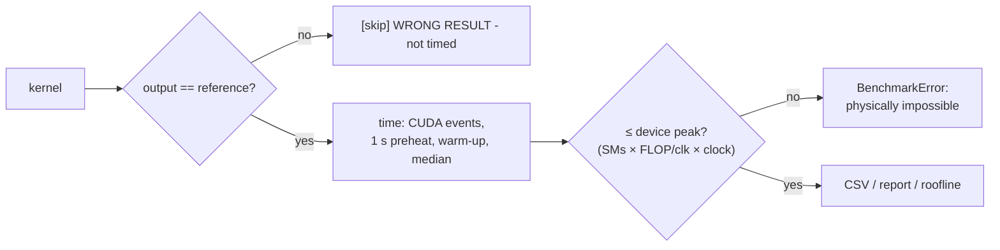
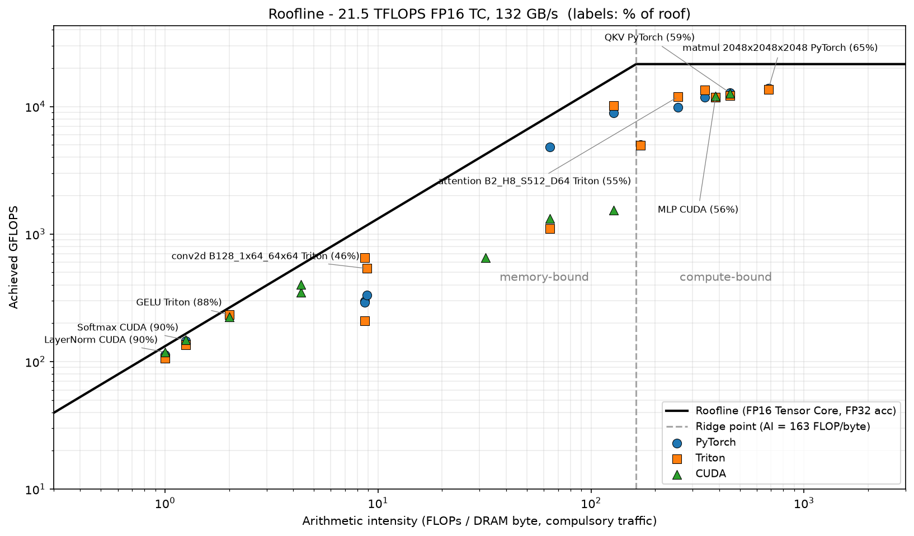
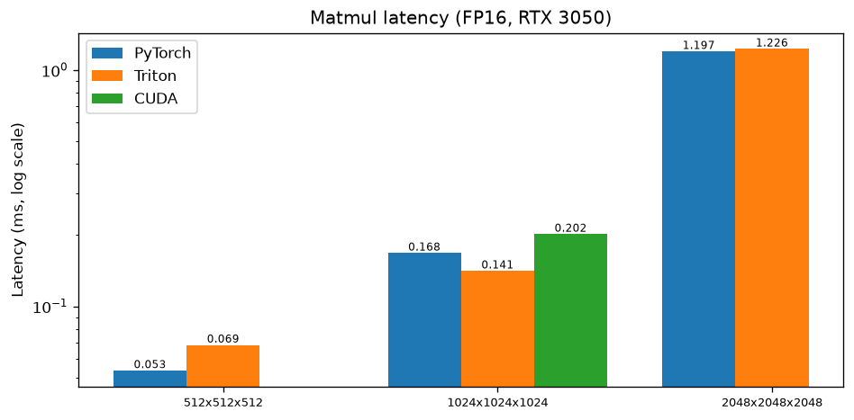
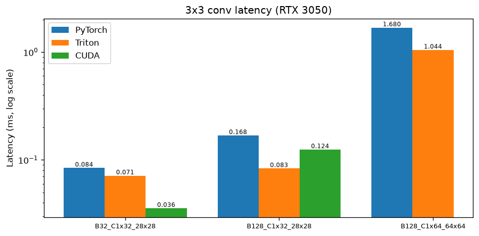
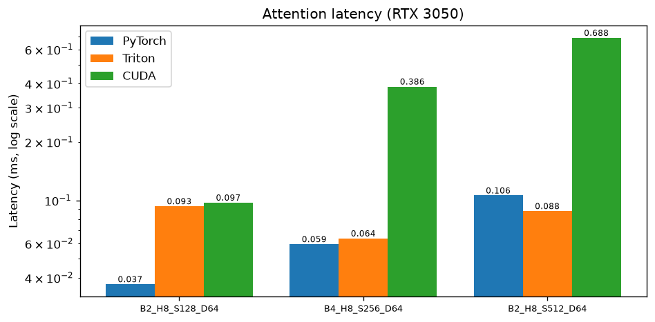
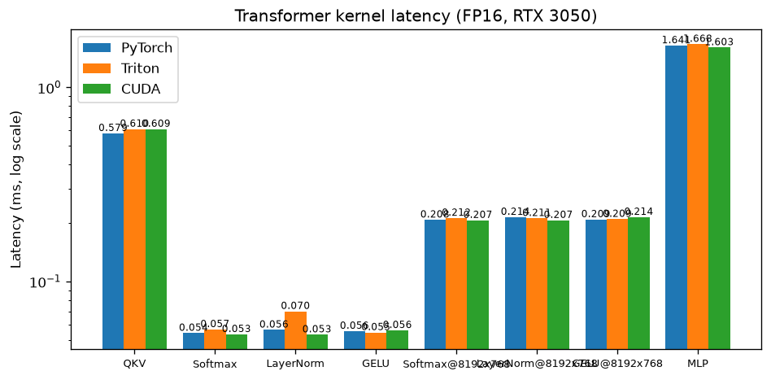

<p align="center">
  <a href="https://github.com/boson316/RTX3050-GPU-Mastery/actions/workflows/ci.yml"></a>
  
  
  
  
  <a href="LICENSE"></a>
</p>

# RTX 3050 GPU Kernel Lab

**Hand-written CUDA and Triton kernels — GEMM, FlashAttention, Transformer blocks, convolution — on a
6 GB laptop GPU, with a verification pipeline that runs without a GPU.**

**Languages:** English · [中文](README.zh-TW.md)

Most GPU-kernel portfolios show speedup charts. This one also shows how the numbers were checked:
every kernel is verified against a reference before it is timed, throughput is
sanity-checked against the hardware's theoretical peak, and the kernel logic is tested in CI on
machines with no GPU at all. Building that pipeline exposed a dozen real bugs and methodology flaws in the first version of this
repo, including two "faster than PyTorch" results that came from kernels doing only part of the work.
They are written up in **[docs/ENGINEERING_LOG.md](docs/ENGINEERING_LOG.md)**.

---

## Highlights

| | What | Where |
|---|---|---|
| ⚡ | **FlashAttention forward** in CUDA (one query row per thread, K/V tiles in shared memory, online softmax with `exp2`, causal tile skipping) and in Triton (autotuned, `tl.dot` on Tensor Cores) | [`flash_attention_simple/`](flash_attention_simple), [`triton_kernels/flash_attention/`](triton_kernels/flash_attention) |
| 🧮 | **Tensor Core GEMM with WMMA**: a 64×64×32 shared-memory block tile, 4 warps × 2×2 fragments, 128-bit copies, padded shared memory. Measured: **79–87 % of cuBLAS at 2048³**; at 1024³, median 81 % with a wide 65.6–109.6 % range | [`cuda_roadmap/level4_tensor_core/`](cuda_roadmap/level4_tensor_core) |
| 🔗 | **Kernel fusion**: Triton linear layer with fused bias + GELU epilogue (the MLP is 2 launches), online softmax (2 passes instead of 3), Welford LayerNorm, conv as 9 vectorised outer products | [`triton_kernels/`](triton_kernels), [`gpu_kernels/transformer/`](gpu_kernels/transformer) |
| 🧪 | **GPU-free verification in CI**: the Triton interpreter runs the real kernels on the CPU, and a **CUDA execution-model emulator** (threads + `std::barrier` for `__syncthreads`, per-warp exchange for `__shfl_xor_sync`) runs the real `__global__` code and turns barrier divergence into a deadlock | [`tests/`](tests) |
| 📈 | **Roofline with device-derived peaks** (SMs × FLOPs/clk × clock from NVML). cuBLAS reaches 67 % of the roof at the NVML maximum clock and 81 % at the clock it actually sustains (2048³) | [`profiling/`](profiling), [`benchmarks/gpu_specs.py`](benchmarks/gpu_specs.py) |
| 🐛 | **Engineering log**: data race, two deadlocks, an out-of-bounds cuBLAS call, a transposed WMMA operand, 4 masking bugs, unfair baselines, and 5 more bugs found on the real GPU, each with root cause, fix and regression test | [`docs/ENGINEERING_LOG.md`](docs/ENGINEERING_LOG.md) |

---

## Correctness first



| Check | Runs on | Covers |
|---|---|---|
| `pytest` with `TRITON_INTERPRET=1` | CI, CPU | all Triton kernels vs PyTorch: odd shapes, non-power-of-2 `head_dim`, causal (46 cases) |
| `tests/cuda_emulation/run_all.sh` | CI, CPU | CUDA FlashAttention, softmax, LayerNorm, bias+GELU, conv3x3 vs naive references (27 cases) |
| `nvcc -arch=sm_86 --Werror all-warnings` | CI | every `.cu` file |
| `pytest` on the GPU | RTX 3050 | compiled Triton kernels in FP32 and FP16, autotuned variants, all three PyTorch CUDA extensions, the timing harness (116 cases) |
| self-verifying CUDA binaries (`VERIFY_*=PASS`) | GPU | all CUDA roadmap kernels incl. WMMA, vs a CPU reference |
| `bench_utils.measure()` | GPU | every benchmark: verify → time → plausibility check |

---

## What's inside

| Module | Contents | Key techniques |
|---|---|---|
| [`cuda_roadmap/`](cuda_roadmap) | 11 self-verifying CUDA benchmarks, Levels 1–4 | coalescing, bank conflicts (`[32][33]` transpose), warp-shuffle reduction, fusion, grid-stride + occupancy API, WMMA |
| [`triton_kernels/`](triton_kernels) | matmul, linear / QKV / MLP, softmax, LayerNorm, GELU, conv3x3, FlashAttention | grouped program order for L2 reuse, `num_stages` pipelining, fused epilogues, autotuning |
| [`flash_attention_simple/`](flash_attention_simple) | CUDA FlashAttention (PyTorch extension + standalone) | online softmax, register-resident accumulators, documented register budget (215 regs, 0 spills) |
| [`gpu_kernels/transformer/`](gpu_kernels/transformer) | QKV, softmax, LayerNorm, GELU, MLP as a PyTorch CUDA extension | row-major cuBLAS via `Yᵀ = WᵀXᵀ`, fused bias+GELU epilogue, Welford statistics |
| [`extension/`](extension) | 3×3 conv (C_in = 1, C_out = 32) as a PyTorch extension | 18×18 halo tile reused for 32 channels × 9 taps |
| [`benchmarks/`](benchmarks) | verified benchmark harness, device-peak query | CUDA events, correctness gate, plausibility ceiling |
| [`profiling/`](profiling) | roofline analysis, Nsight Compute / Systems scripts | arithmetic intensity vs. measured throughput |
| [`tests/`](tests) | Triton interpreter tests, CUDA CPU emulator | see above |

---

## Results

**GPU:** NVIDIA GeForce RTX 3050 6GB Laptop (Ampere, sm_86), 20 SMs, 96-bit bus, 43 W, AC power, best-performance mode.
**Software:** driver 610.62, CUDA 12.4, PyTorch 2.6.0, Triton 3.2.0, MSVC 14.50. Full details: [`results/v2/environment.md`](results/v2/environment.md).

Each cell is **median latency in ms (min–max of 3 runs)**. Every kernel passed its correctness check before it was timed. Raw logs and CSVs are in [`results/v2/`](results/v2); the summary is [`results/v2/SUMMARY.md`](results/v2/SUMMARY.md).

| Metric | Value |
|---|---|
| Peak at NVML max clock | 21.5 TFLOPS @ 2100 MHz |
| Median SM clock under load | 1747 MHz |
| Peak at the sustained clock | 17.9 TFLOPS |
| Peak DRAM bandwidth | 132 GB/s |

The roof is reported both ways because 2100 MHz is what NVML reports as the maximum, while this 43 W laptop ran at about 1747 MHz under these loads.

### Roofline



The plot uses the NVML-maximum roof and labels one point per kernel. The table adds the sustained-clock roof.

| Kernel | Bound | % of NVML-max roof (PyTorch / Triton / CUDA) | % of sustained roof (PyTorch / Triton / CUDA) |
|---|---|---|---|
| GEMM 2048³ | compute | 67 / 65 / — | 81 / 78 / — |
| QKV | compute | 62 / 59 / 48 | 74 / 70 / 58 |
| MLP | compute | 56 / 57 / 53 | 68 / 68 / 64 |
| Attention S512 | compute | 48 / 57 / 9 | 57 / 68 / 9 |
| Conv B128 64×64 | memory | 29 / 47 / — | 29 / 47 / — |
| Conv B128 28×28 | memory | 26 / 44 / 70 | 26 / 44 / 70 |
| Softmax | memory | 88 / 78 / 50 | 88 / 78 / 50 |
| LayerNorm | memory | 84 / 65 / 43 | 84 / 65 / 43 |
| GELU | memory | 86 / 78 / 85 | 86 / 78 / 85 |

- **GEMM is compute-bound and cuBLAS is close to what this GPU sustains.** That leaves little room for a custom kernel: Triton matches it at 2048³ and CUDA reaches about the same range at 1024³.
- **Softmax, LayerNorm and GELU are bandwidth-bound.** PyTorch is already at 84–88 % of the DRAM roof, so a custom kernel cannot win by much. The CUDA softmax and LayerNorm are slower, at 50 % and 43 %.
- **cuDNN reaches only 26–29 % of the memory roof for these C_in = 1 convolutions**, which is why specialised kernels can win there.

### Measurements

Precision: the GEMM and Transformer rows are FP16, as are the PyTorch and Triton conv and attention rows. **The CUDA conv and attention kernels use FP32 storage**, so they move twice the bytes, and the attention kernel runs on CUDA cores rather than Tensor Cores. The CUDA GELU implements the tanh form; the other two implement the exact form. Each is verified against its own definition.

| Kernel | Shape | PyTorch | Triton | CUDA |
|---|---|---|---|---|
| GEMM | 512×512×512 | 0.053 (0.053–0.066) · 5.03 TFLOPS | 0.069 (0.060–0.069) · 3.92 TFLOPS | — |
| GEMM | 1024×1024×1024 | 0.168 (0.168–0.184) · 12.80 TFLOPS | 0.141 (0.138–0.155) · 15.23 TFLOPS | 0.202 (0.201–0.222) · 10.65 TFLOPS |
| GEMM | 2048×2048×2048 | 1.197 (1.178–1.205) · 14.36 TFLOPS | 1.226 (1.210–1.233) · 14.01 TFLOPS | — |
| QKV | 2048×768→2304 | 0.545 (0.537–0.609) · 13.30 TFLOPS | 0.587 (0.546–0.674) · 12.36 TFLOPS | 0.675 (0.674–0.775) · 10.74 TFLOPS |
| MLP | 2048×768→3072→768 | 1.612 (1.584–1.708) · 11.99 TFLOPS | 1.634 (1.630–1.698) · 11.83 TFLOPS | 1.681 (1.679–1.726) · 11.50 TFLOPS |
| Softmax | 2048×768 | 0.054 (0.054–0.055) · 116 GB/s | 0.057 (0.057–0.060) · 110 GB/s | 0.094 (0.093–0.099) · 67 GB/s |
| LayerNorm | 2048×768 | 0.056 (0.056–0.077) · 112 GB/s | 0.067 (0.065–0.073) · 94 GB/s | 0.111 (0.110–0.118) · 57 GB/s |
| GELU | 1572864 | 0.056 (0.055–0.056) · 113 GB/s | 0.054 (0.054–0.060) · 116 GB/s | 0.056 (0.056–0.057) · 112 GB/s |
| Conv 3×3 | B32_C1x32_28x28 | 0.084 (0.041–0.086) · 0.15 TFLOPS | 0.071 (0.067–0.103) · 0.17 TFLOPS | 0.036 (0.035–0.036) · 0.35 TFLOPS |
| Conv 3×3 | B128_C1x32_28x28 | 0.168 (0.168–0.171) · 0.30 TFLOPS | 0.083 (0.076–0.102) · 0.60 TFLOPS | 0.124 (0.124–0.125) · 0.40 TFLOPS |
| Conv 3×3 | B128_C1x64_64x64 | 1.680 (1.669–1.710) · 0.34 TFLOPS | 1.044 (1.019–1.049) · 0.54 TFLOPS | — |
| Attention | B2_H8_S128_D64 | 0.037 (0.016–0.049) · 1.81 TFLOPS | 0.093 (0.071–0.128) · 0.72 TFLOPS | 0.097 (0.097–0.107) · 0.69 TFLOPS |
| Attention | B4_H8_S256_D64 | 0.059 (0.058–0.060) · 9.02 TFLOPS | 0.064 (0.060–0.141) · 8.42 TFLOPS | 0.386 (0.385–0.405) · 1.39 TFLOPS |
| Attention | B2_H8_S512_D64 | 0.106 (0.105–0.107) · 10.13 TFLOPS | 0.088 (0.087–0.097) · 12.19 TFLOPS | 0.688 (0.678–0.691) · 1.56 TFLOPS |






**Where the custom kernels lose, and why:**
- **CUDA QKV / MLP vs PyTorch:** the whole QKV gap (0.13 ms) is the separate bias kernel re-reading and re-writing the 2048×2304 output (18.9 MB at 132 GB/s ≈ 0.14 ms); the MLP's extra bias pass (6 MB ≈ 0.05 ms) matches its gap. PyTorch fuses bias into the GEMM epilogue. *v2.1 does the same with cublasLt; re-measurement pending.*
- **CUDA softmax and LayerNorm are about 2x slower than PyTorch:** one block per row with one 2-byte load per thread leaves too few memory requests in flight, and the row is read twice. *v2.1 adds a warp-per-row path with 128-bit loads and the row held in registers; re-measurement pending.*
- CUDA attention at S = 512 is about 8x slower than Triton, in FP32 on CUDA cores against FP16 on Tensor Cores.
- PyTorch wins GEMM at 512³ and SDPA wins attention at S = 128 and S = 256, though the S = 128 and S = 256 rows are close to the timing limits below.

**Where they win:** CUDA conv at B = 32, Triton conv at B = 128, Triton GEMM at 1024³, and Triton attention at S = 512.

**Row-wise kernels at 2048×768 sit on Triton's launch floor** (~0.055 ms, see *Limits* below), so those Triton rows mostly measure Python launch cost. At 8192×768 the kernels themselves are measured: softmax PyTorch 0.207 ms (122 GB/s, 92 % of DRAM peak) vs Triton 0.210 ms (120 GB/s), two runs each ([`phase4_softmax_run1.log`](results/v2/logs/phase4_softmax_run1.log), [`run2`](results/v2/logs/phase4_softmax_run2.log)). Both are at the bandwidth wall. `benchmark_transformer.py` now measures all row-wise kernels at both sizes.

### FlashAttention at long sequences (B=1, H=8, D=64, FP32)

| S | Implementation | Latency (ms) | Extra VRAM (MiB) | Max error vs FP64 |
|---|---|---|---|---|
| 1024 | SDPA | 1.257 (1.254–1.271) | 2.0 | 1.104e-06 |
| 1024 | Triton | 0.357 (0.356–0.357) | 2.0 | 1.364e-03 |
| 1024 | CUDA | 1.238 (1.233–1.241) | 2.0 | 8.538e-07 |
| 1024 | Matrix-materializing | — | 72.1 | — |
| 2048 | SDPA | 4.752 (4.750–4.775) | 4.0 | 7.044e-07 |
| 2048 | Triton | 1.291 (1.289–1.301) | 4.0 | 8.341e-04 |
| 2048 | CUDA | 4.834 (4.817–4.836) | 4.0 | 6.183e-07 |
| 2048 | Matrix-materializing | — | 256.0 | — |
| 4096 | SDPA | 20.181 (20.171–20.210) | 8.0 | 3.338e-07 |
| 4096 | Triton | 5.115 (5.098–5.119) | 8.0 | 5.551e-04 |
| 4096 | CUDA | 17.303 (17.283–17.314) | 8.0 | 6.030e-07 |
| 4096 | Matrix-materializing | — | 1024.0 | — |

- **Memory:** all three implementations use only the output buffer. A matrix-materializing attention needs 1024 MiB at S = 4096. PyTorch's SDPA already avoids that here (its backend choice is `EFFICIENT_ATTENTION`), so the saving is against the naive form, not against SDPA.
- **The Triton column is TF32, not FP32.** On FP32 inputs `tl.dot` defaults to TF32 Tensor Cores (10-bit mantissa, relative precision ~5e-4), which is exactly the 5.6e-4–1.4e-3 error measured. SDPA (memory-efficient backend) and the CUDA kernel run IEEE FP32 on CUDA cores. So Triton's 4x is a Tensor-Core-vs-CUDA-core result, not a better kernel, and is not comparable to the other two columns.
- **The fair IEEE FP32 race is CUDA vs SDPA:** equal up to S = 2048, and the CUDA kernel is **14 % faster at S = 4096** (17.3 vs 20.2 ms) at the same accuracy.
- *v2.1:* `flash_attention_triton(..., precision="ieee" | "tf32")` and [`benchmarks/benchmark_attention_longseq.py`](benchmarks/benchmark_attention_longseq.py) report FP16 (what models use: SDPA FlashAttention-2 vs Triton), IEEE FP32 (SDPA vs Triton vs CUDA) and TF32 separately, each with its error vs FP64. Re-measurement pending.

### WMMA tiled GEMM vs cuBLAS (FP16)

| Metric | Median | Min | Max | Runs |
|---|---|---|---|---|
| 1024³ WMMA tiled (GFLOPS) | 7530.6 | 7489.8 | 10979.9 | 12 |
| 1024³ cuBLAS (GFLOPS) | 11366.8 | 6944.2 | 11459.8 | 12 |
| 1024³ WMMA % of cuBLAS (%) | 81.4 | 65.6 | 109.6 | 12 |
| 2048³ WMMA tiled (GFLOPS) | 11648.3 | 11358.3 | 12122.3 | 6 |
| 2048³ cuBLAS (GFLOPS) | 14123.6 | 13969.4 | 14364.1 | 6 |
| 2048³ WMMA % of cuBLAS (%) | 81.9 | 79.1 | 86.5 | 6 |

These are independent process runs, and each one passed verification. At 2048³ the runs are consistent. At 1024³ the results fall into two groups, and whole runs land in the slower one. **The cause is not known yet**: a 1 s preheat did not remove it ([`results/v2/logs/wmma_old_vs_new.log`](results/v2/logs/wmma_old_vs_new.log)). Whole-run clusters that also hit cuBLAS point at GPU state (P-state, power cap) rather than the kernel; [`tools/gpu_state_probe.py`](tools/gpu_state_probe.py) records P-state, clocks, power and NVML throttle reasons per run to test that. Do not read a single run of this benchmark as the answer.

All 11 CUDA roadmap benchmarks pass verification; results are in [`cuda_roadmap/results.md`](cuda_roadmap/results.md). Not every "optimization" helps: the bank-conflict padding measured 1.00x and the persistent grid-stride kernel 0.97x.

### Limits of these numbers

- **Launch floor.** Below these times, a measurement reflects host-side launch cost rather than the kernel. Triton's Python launch path has the highest floor, so its sub-0.1 ms rows mostly measure that:

| Implementation | Launch floor (ms) |
|---|---|
| PyTorch | 0.0112 |
| Triton | 0.0553 |
| CUDA | 0.0092 |

- **Noise.** Kernels under about 0.1 ms still vary between runs after the timing fix (see the ranges), which is why the tables give ranges.
- **One laptop.** Thermal and power limits apply. The compiler is also outside CUDA 12.4's supported range (MSVC 14.50 with `-allow-unsupported-compiler`).
- **Nsight Compute was not run**, so the bottleneck explanations come from the roofline, not from hardware counters.

---

## Quick start

```bash
git clone https://github.com/boson316/RTX3050-GPU-Mastery.git && cd RTX3050-GPU-Mastery
pip install torch==2.6.0 torchvision==0.21.0 --index-url https://download.pytorch.org/whl/cu124
pip install -r requirements.txt "triton==3.2.*" pytest nvidia-ml-py      # Windows: triton-windows==3.2.*

pytest -q                              # kernel correctness (GPU; with no GPU, needs torch CPU and the latest Triton, as in CI)
tests/cuda_emulation/run_all.sh        # CUDA kernel logic on the CPU (needs g++ >= 11)
python benchmarks/gpu_specs.py         # theoretical peaks of this GPU
scripts/reproduce_all.sh               # everything: verify, benchmark, report, roofline
```

| Task | Command |
|---|---|
| CUDA roadmap | `cd cuda_roadmap && ./build.sh && cd .. && python cuda_roadmap/run_benchmarks.py` |
| Triton kernels | `python -m triton_kernels.run_benchmarks` |
| FlashAttention (CUDA vs Triton vs SDPA) | `python benchmarks/benchmark_attention.py` |
| Transformer blocks | `python benchmarks/benchmark_transformer.py` |
| Matmul / conv | `python benchmarks/benchmark_matmul.py`, `python benchmarks/benchmark_conv.py` |
| Full report | `python tools/performance_dashboard.py --skip-mnist` → [`benchmarks/performance_report.md`](benchmarks/performance_report.md) |
| Roofline | `python profiling/roofline_analysis.py` |
| Nsight | `python profiling/run_nsight_profiling.py` ([guide](docs/nsight_profiling_guide.md)) |

Windows: build the CUDA extensions from an *x64 Native Tools Command Prompt for VS*.

---

## Learning material

- [`tutorials/`](tutorials): CUDA basics → shared memory → tiling → Triton → FlashAttention → Transformer kernels
- [`docs/`](docs/INDEX.md): memory hierarchy, optimisation guide, roofline, Nsight, per-level kernel notes
- [`notebooks/`](notebooks): interactive walk-throughs

## Project layout

```
cuda_roadmap/            Level 1-4 CUDA benchmarks + common/bench_common.cuh (timing + verification)
triton_kernels/          Triton kernels (matmul, linear/qkv/mlp, softmax, layernorm, gelu, conv, flash_attention)
flash_attention_simple/  CUDA FlashAttention: flash_attention_kernel.cuh, PyTorch extension, standalone
gpu_kernels/             transformer CUDA extension + small standalone kernels
extension/               conv3x3 PyTorch extension (conv3x3_kernel.cuh)
benchmarks/              verified benchmark harness (bench_utils.py), gpu_specs.py, results CSV
profiling/               roofline analysis, Nsight scripts and reports
tests/                   Triton interpreter tests, cuda_emulation/ (CPU emulator for CUDA kernels)
docs/ tutorials/ notebooks/
```

## License

[MIT](LICENSE)
