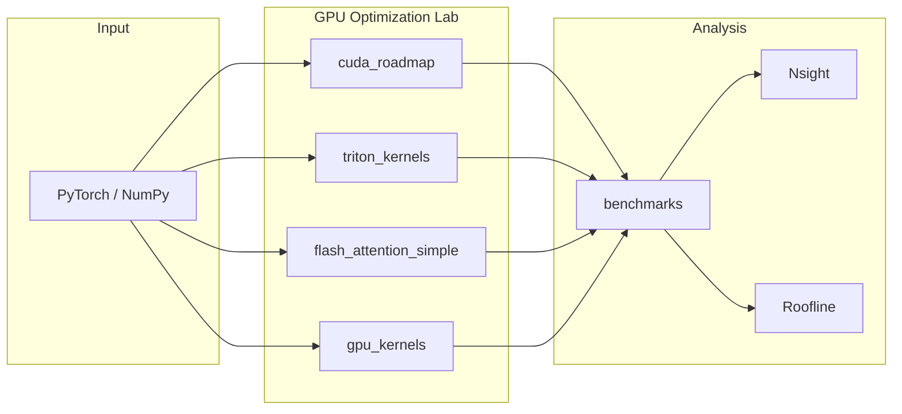
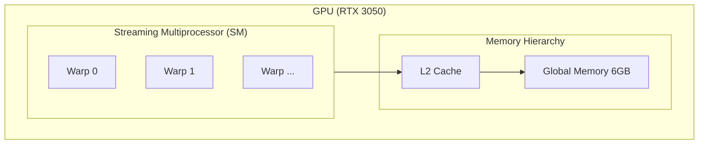
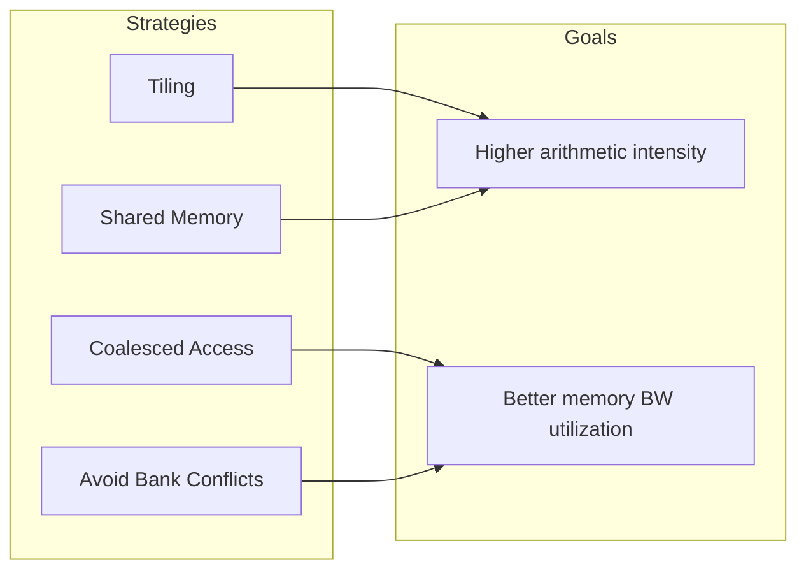
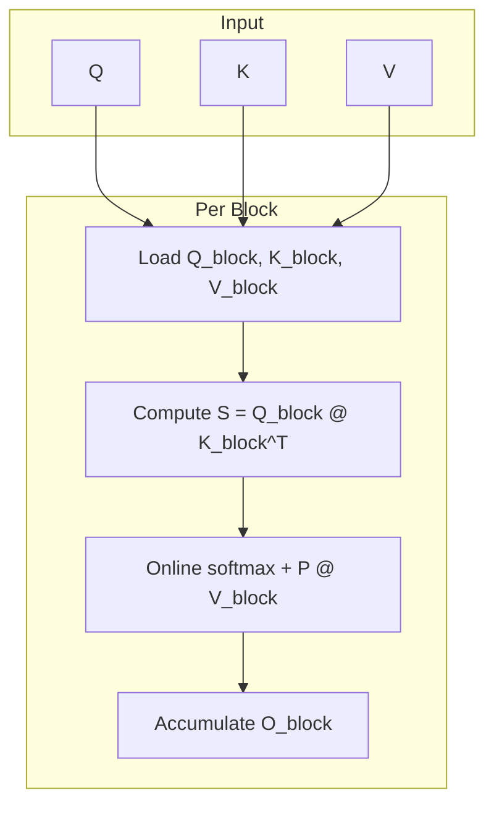
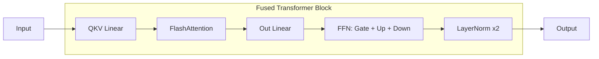
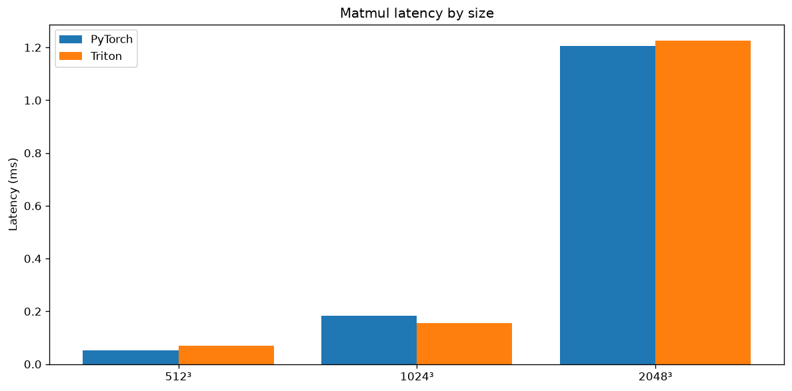
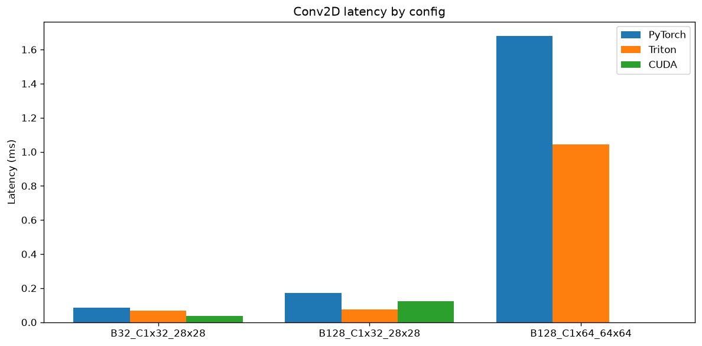
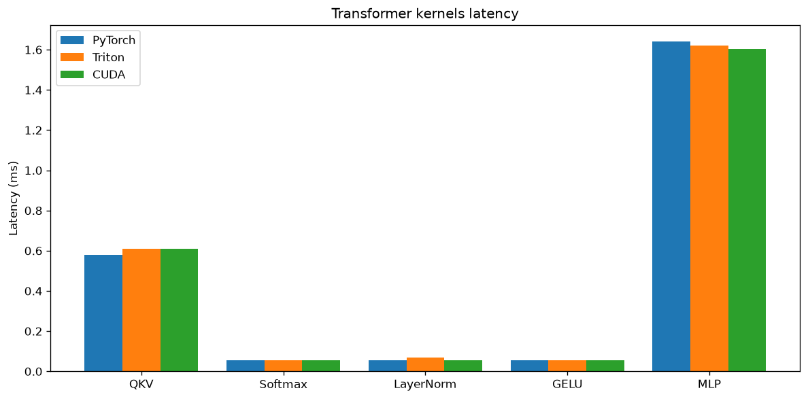
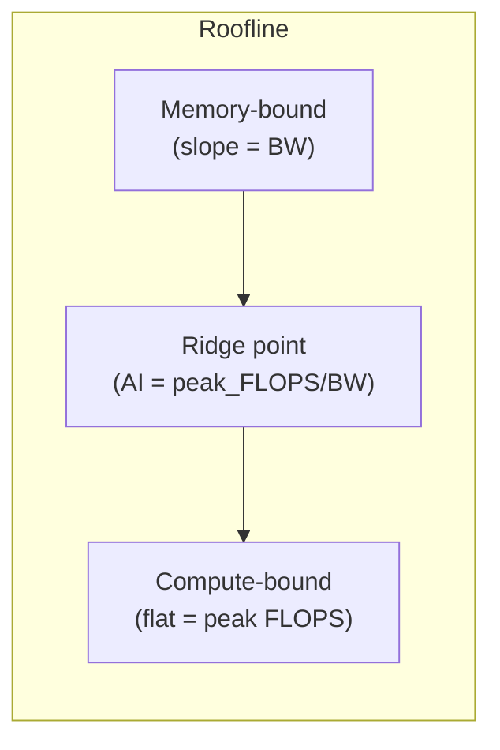

<p align="center">
  <a href="https://developer.nvidia.com/cuda-toolkit"></a>
  <a href="https://pytorch.org"></a>
  <a href="https://github.com/openai/triton"></a>
  
  
  <a href="LICENSE"></a>
</p>

<p align="center">
  <strong>⚡ RTX 3050 GPU Optimization Lab</strong> — Hands-on <strong>GPU engineering portfolio</strong>: CUDA · Triton · FlashAttention · Transformer kernels · Nsight · Roofline.
</p>

<p align="center">
  <strong>Languages:</strong> <a href="README.md">English</a> · <a href="README.zh-TW.md">中文</a>
</p>

# ⚡ RTX 3050 GPU Optimization Lab

> A **high-performance GPU kernel lab** benchmarked on **NVIDIA GeForce RTX 3050 Laptop (Ampere sm_86)** — from CUDA fundamentals to Triton, FlashAttention, and Transformer blocks, with systematic profiling. Built as a **GPU / HPC portfolio** project.

Legacy layout and highlights: [README.legacy.md](README.legacy.md). 中文版: [README.zh-TW.md](README.zh-TW.md).

---

## 📋 Table of contents

| # | Section |
|---|---------|
| 1 | [Overview](#1-overview) |
| 2 | [GPU architecture](#2-gpu-architecture) |
| 3 | [CUDA experiments](#3-cuda-experiments) |
| 4 | [Triton experiments](#4-triton-experiments) |
| 5 | [FlashAttention](#5-flashattention) |
| 6 | [Transformer GPU kernels](#6-transformer-gpu-kernels) |
| 7 | [Benchmarks](#7-benchmarks) |
| 8 | [Nsight profiling](#8-nsight-profiling) |
| 9 | [Roofline analysis](#9-roofline-analysis) |
| — | [Install & reproduce](#-install--easy-reproduce) · [Example commands](#example-commands-running-kernels) |

**Getting started** → [docs/getting_started.md](docs/getting_started.md) · [Docs index](docs/INDEX.md) · [Notebooks](notebooks/README.md) · [**Step-by-step tutorials**](tutorials/README.md) · [One-click reproduce](scripts/README.md)

---

## 1. Overview

This lab focuses on **writing, optimizing, and profiling GPU kernels** on an **RTX 3050 6GB** laptop GPU — from basic CUDA through Triton, FlashAttention, and Transformer building blocks, with **Nsight** and **Roofline** analysis.



| Module | Description |
|--------|-------------|
| **cuda_roadmap** | Leveled CUDA: vector add, reduction, naive/tiled matmul, WMMA Tensor Core |
| **triton_kernels** | Triton: matmul, conv, layernorm, softmax, flash_attention |
| **flash_attention_simple** | FlashAttention: PyTorch reference, CUDA, Triton |
| **gpu_kernels** | Pure CUDA: vector_add, reduction, matrix_mul, conv2d, transformer |
| **benchmarks / profiling** | Benchmarks, Nsight reports, Roofline plots |

---

## 2. GPU architecture

Target device: **NVIDIA GeForce RTX 3050 Laptop GPU** — Ampere (sm_86), 6GB GDDR6.

### SM and memory hierarchy



| Level | Scope | Latency (approx.) | Bandwidth | Kernel use |
|-------|--------|-------------------|-----------|------------|
| **Registers** | Per thread | 0 cycles | Highest | Locals, loop indices |
| **Shared memory** | Per block | ~20–30 cycles | Very high | Tiling, reduction |
| **L1 / L2** | Per-SM / GPU | Varies | High | Implicit from global loads |
| **Global (VRAM)** | GPU | 200–400 cycles | Lower | Large tensors, I/O |

### RTX 3050 Laptop specs

| Item | Value |
|------|-------|
| Architecture | Ampere (sm_86) |
| FP32 peak | ~4.5 TFLOPS |
| FP16 Tensor Core | ~9 TFLOPS |
| Memory bandwidth | ~192 GB/s |
| VRAM | 6 GB GDDR6 |

### Optimization mapping



See: [docs/gpu_memory_hierarchy.md](docs/gpu_memory_hierarchy.md), [docs/optimization_guide.md](docs/optimization_guide.md).

---

## 3. CUDA experiments

**cuda_roadmap** provides leveled CUDA kernels from naive to optimized, compared against CPU / PyTorch.

### Levels

| Level | Kernels | Focus |
|-------|---------|--------|
| **Level 1** | Vector add, reduction, naive matmul | thread/block/grid, coalescing |
| **Level 2** | Tiled matmul, coalescing, bank conflict | Shared memory, tiling |
| **Level 3** | Warp shuffle, fused ops, persistent kernel | Warp-level, fusion |
| **Level 4** | FP16 Tensor Core matmul, WMMA | Tensor Cores, FP16 |

### GEMM evolution


### Representative results (RTX 3050)

| Kernel | Naive / baseline | Optimized | Notes |
|--------|------------------|-----------|-------|
| Vector add (2²⁰) | 1 elem/thread coalesced | **float4** vectorized | Fewer transactions |
| Reduction (1M) | atomicAdd (slow) | **Shared memory** tree | **0.76 ms** |
| Matrix mul (1024²) | Global only | **Tiled** shared memory | **521×** vs CPU |
| FP16 matmul | FP32 CUDA cores | **WMMA** Tensor Core | Level 4 |

### Run

```bash
cd cuda_roadmap && ./build.sh   # Windows: build.bat
python cuda_roadmap/run_benchmarks.py
```

Docs: [docs/cuda_roadmap.md](docs/cuda_roadmap.md), [docs/level1_kernels.md](docs/level1_kernels.md)–[level4_tensor_core.md](docs/level4_tensor_core.md).

---

## 4. Triton experiments

**triton_kernels** — high-level Triton JIT: matmul, conv, layernorm, softmax, Flash Attention.

| Module | Description | Variants |
|--------|-------------|----------|
| **matmul** | C = A @ B | Baseline, optimized, autotuned |
| **conv** | 3×3 Conv2D FP16 | Tile reuse, autotune |
| **layernorm** | Fused normalize + affine | Baseline, optimized, autotune |
| **softmax** | Softmax on last dim | Max / sum / normalize |
| **flash_attention** | Fused softmax(QKᵀ/√d)V | Online softmax, causal |

### Triton vs CUDA

| Aspect | CUDA | Triton |
|--------|------|--------|
| Model | thread/block/grid, explicit indices | Block-level abstraction |
| Memory | Manual shared/global | `tl.load` / `tl.store` |
| Tuning | Often manual | Some auto scheduling |
| Portability | Architecture-specific tweaks | Same program, many GPUs |

### Run

```bash
python -m triton_kernels.run_benchmarks
```

Install: `pip install triton` (Linux) or `pip install triton-windows` (Windows).  
See: [triton_kernels/README.md](triton_kernels/README.md).

---

## 5. FlashAttention

**flash_attention_simple** — memory-efficient attention without materializing the full S×S matrix, using **tiling** and **online softmax** in shared memory.

### Algorithm sketch



- **Tiling:** Load Q/K/V blocks into shared memory; compute only the current S_ij block.
- **Online softmax:** Running max/sum for stable softmax without storing full S.
- **Result:** O(N) extra memory, less HBM traffic — good for long sequences.

### Implementations

| Implementation | Path | Memory | Notes |
|----------------|------|--------|-------|
| **PyTorch reference** | correctness only | O(S²) | Gold standard |
| **CUDA** | `flash_attention_cuda.cu` | Tiled, shared mem | D ≤ 64 |
| **Triton** | `triton_kernels/flash_attention` | Tiled, no full matrix | — |

### Build & benchmark

```bash
cd flash_attention_simple && build.bat   # optional standalone CUDA build
python flash_attention_simple/benchmark_flash_attention.py
```

Compares PyTorch, CUDA, Triton at B=2, H=8, D=64, S ∈ {128, 256, 512, 1024}.  
See: [flash_attention_simple/README.md](flash_attention_simple/README.md).

---

## 6. Transformer GPU kernels

**gpu_kernels/transformer** — FP16 Transformer building blocks: PyTorch baseline, Triton, optional custom CUDA.

### Fused block



| Kernel | Role | Notes |
|--------|------|-------|
| **Fused QKV** | y = x @ W_qkv + b | cuBLAS matmul + bias kernel |
| **Softmax** | Row-wise on last dim | 3-pass: max, sum, normalize |
| **LayerNorm** | (x − μ) * rstd * γ + β | Fused on last dim |
| **GELU** | 0.5·x·(1 + tanh(…)) | FP16, float32 accumulate |
| **Fused MLP** | linear2(GELU(linear1(x))) | Two matmuls + GELU |

### Run

```bash
python benchmarks/benchmark_transformer.py
```

Env: `TRANSFORMER_BENCHMARK_FULL=1` (larger B/S), `TRANSFORMER_BENCHMARK_CUDA=1` (custom CUDA).  
See: [gpu_kernels/transformer/README.md](gpu_kernels/transformer/README.md), [docs/transformer_benchmark_gpu_load.md](docs/transformer_benchmark_gpu_load.md).

---

## 7. Benchmarks

Representative numbers on **RTX 3050 Laptop 6GB**; your results may vary.

### Performance at a glance

| Benchmark | Implementation | Latency (ms) | Throughput | Note |
|-----------|----------------|--------------|------------|------|
| **Matmul 1024³** | PyTorch (cuBLAS) | ~0.17 | ~12.8 TFLOPS | FP16 |
| **Matmul 1024³** | Triton | ~0.15 | ~14.3 TFLOPS | FP16 |
| **Conv 3×3 (B=128, 64×64)** | Triton | ~0.80 | ~705 GFLOPS | FP16 |
| **Attention (B=2, S=512, D=64)** | PyTorch SDPA | ~0.10 | ~10.2 TFLOPS | FP16 |
| **Transformer QKV (B=8, S=256)** | PyTorch | ~0.89 | ~8.1 TFLOPS | FP16 |
| **Reduction 1M** | CUDA shared mem | **0.76** | — | Level 1 |
| **Matrix mul 1024²** | CUDA tiled | — | **521×** vs CPU | Level 2 |

*Run `python tools/performance_dashboard.py` for full tables and charts on your machine.*

### Benchmark charts

Charts are generated under `benchmarks/plots/` and `benchmarks/` after running benchmarks or `tools/performance_dashboard.py`.

| Chart | Path | Description |
|-------|------|-------------|
| Matmul latency by size | `benchmarks/plots/matmul_latency_by_size.png` | PyTorch vs Triton 512³–2048³ |
| Conv comparison | `benchmarks/plots/conv_latency_by_config.png` | Conv2D across configs |
| Transformer kernels | `benchmarks/plots/transformer_latency_by_kernel.png` | QKV, Softmax, LayerNorm, GELU, MLP |
| Matrix mul speedup | `benchmarks/matrix_mul_speedup.png` | CPU vs GPU (e.g. 521×) |
| Roofline | `profiling/nsight_reports/roofline_model.png` | Memory- vs compute-bound |

*Images below appear after you run benchmarks.*


*Matmul: PyTorch vs Triton (512³–2048³)*


*Conv2D: latency by config*


*Transformer kernels: QKV, Softmax, LayerNorm, GELU, MLP*

### Scripts

| Script | Output |
|--------|--------|
| `benchmarks/benchmark_matmul.py` | PyTorch vs Triton matmul; GFLOPS |
| `benchmarks/benchmark_conv.py` | torch vs Extension vs Triton |
| `benchmarks/benchmark_attention.py` | SDPA vs Triton Flash |
| `benchmarks/benchmark_transformer.py` | Per-kernel latency & bandwidth |
| `benchmarks/generate_charts.py` | Aggregate charts |

```bash
python benchmarks/benchmark_matmul.py
python benchmarks/benchmark_conv.py
python benchmarks/benchmark_attention.py
python benchmarks/generate_charts.py   # add --skip-mnist to skip training
```

More: [benchmarks/README.en.md](benchmarks/README.en.md).

---

## 8. Nsight profiling

Use **NVIDIA Nsight Compute** and **Nsight Systems** for kernel- and system-level data.

### Nsight Compute metrics (examples)

| Metric | Meaning |
|--------|---------|
| **Occupancy** | Active threads per SM vs theoretical max |
| **Memory bandwidth** | DRAM / L2 utilization |
| **Warp divergence** | Warp efficiency (low ⇒ more divergence) |
| **Timeline** | Kernel order & duration (Nsight Systems) |

### Artifacts

| File | Tool | Description |
|------|------|-------------|
| `transformer_timeline.nsys-rep` | Nsight Systems | Kernel timeline |
| `transformer_kernels.ncu-rep` | Nsight Compute | Per-kernel metrics |
| `transformer_kernels_metrics.json` | Parser | For Roofline |
| **roofline_model.png** | `plot_roofline.py` | Memory- vs compute-bound |

### Commands

```bash
# Profiling (SKIP_NSYS=1 skips timeline; NCU_QUICK=1 ~1 min)
set SKIP_NSYS=1
set NCU_QUICK=1
python profiling/run_nsight_profiling.py

# Roofline plot
python profiling/roofline_analysis/plot_roofline.py
```

Output: `profiling/nsight_reports/roofline_model.png`.  
See: [profiling/nsight_reports/README.md](profiling/nsight_reports/README.md), [docs/nsight_profiling_guide.md](docs/nsight_profiling_guide.md).

---

## 9. Roofline analysis

Plot **arithmetic intensity (AI)** vs peak bandwidth/FLOPS to classify kernels as **compute-bound** or **memory-bound**.

- **AI** = FLOPs ÷ (bytes read + written).
- **Ridge point** = peak_FLOPS ÷ peak_BW; **AI < ridge** ⇒ memory-bound; **AI > ridge** ⇒ compute-bound.



### RTX 3050 sketch (ridge ≈ 4.5e9 / 192e9 ≈ 23 FLOP/Byte)

```
GFLOPS
  ^
  |                    *-------- Peak Compute (~4.5 FP32)
  |                   /
  |                  /
  |                 *  GEMM / QKV
  |                /
  |               /
  |              *----------- Ridge (AI ≈ 23)
  |             /
  |            *  FlashAttn
  |           /
  |          *  Softmax / LayerNorm
  |         /
  +--------*---------------------------------> Arithmetic Intensity (log)
```

```bash
python profiling/roofline_analysis/plot_roofline.py
```

See: [docs/optimization_guide.md](docs/optimization_guide.md), [docs/roofline_analysis.md](docs/roofline_analysis.md).

---

## 🗂️ Project layout

```
RTX3050-GPU-Mastery/
├── docs/                   # Docs (INDEX, getting_started, memory hierarchy, roadmap)
├── tutorials/              # Step-by-step: CUDA, shared mem, tiling, Triton, FlashAttention, Transformer
├── notebooks/              # Jupyter notebooks (01–04, RTX 3050 examples)
├── scripts/                # One-click reproduce: reproduce_all.bat / .sh
├── benchmarks/             # matmul, conv, attention, transformer + generate_charts.py
├── profiling/              # Nsight reports + roofline_analysis
├── cuda_roadmap/           # CUDA levels 1–4
├── gpu_kernels/            # Pure CUDA: vector_add, reduction, matrix_mul, conv2d, transformer
├── triton_kernels/         # Triton: matmul, conv, layernorm, softmax, flash_attention
├── flash_attention_simple/ # FlashAttention: PyTorch, CUDA, Triton
├── extension/              # PyTorch CUDA Extension (conv)
├── requirements.txt
├── README.md               # English main README (default)
└── README.zh-TW.md         # Chinese README
```

---

## 🚀 Install & easy reproduce

### Reproduce in 3 steps

```bash
# 1. Clone and install (from repo root)
git clone https://github.com/boson316/RTX3050-GPU-Mastery.git
cd RTX3050-GPU-Mastery
pip install -r requirements.txt
pip install torch torchvision --index-url https://download.pytorch.org/whl/cu124
pip install triton matplotlib ninja
# Windows: pip install triton-windows

# 2. Run all benchmarks and generate report (one command)
python tools/performance_dashboard.py --skip-mnist

# 3. (Optional) CUDA roadmap + extension
cd cuda_roadmap && ./build.sh   # or build.bat on Windows
cd extension && pip install --no-build-isolation .
```

*Full setup:* [docs/getting_started.md](docs/getting_started.md)

### Example commands: running kernels

All commands from **repository root**.

| What | Command |
|------|---------|
| **CUDA Level 1–4** | `cd cuda_roadmap && ./build.sh && python run_benchmarks.py` |
| **Triton (matmul, conv, softmax, etc.)** | `python -m triton_kernels.run_benchmarks` |
| **FlashAttention** | `python flash_attention_simple/benchmark_flash_attention.py` |
| **Transformer kernels** | `python benchmarks/benchmark_transformer.py` |
| **Matmul only** | `python benchmarks/benchmark_matmul.py` |
| **Conv only** | `python benchmarks/benchmark_conv.py` |
| **Attention only** | `python benchmarks/benchmark_attention.py` |
| **Full dashboard** | `python tools/performance_dashboard.py` |
| **One-click reproduce** | `scripts/reproduce_all.bat` (Windows) or `./scripts/reproduce_all.sh` |
| **Roofline plot** | `python profiling/roofline_analysis/plot_roofline.py` |

### Install (detailed)

```bash
pip install -r requirements.txt
pip install torch torchvision --index-url https://download.pytorch.org/whl/cu124
pip install triton matplotlib ninja
# Windows Triton: pip install triton-windows

cd cuda_roadmap && ./build.sh   # Windows: build.bat
cd extension && pip install --no-build-isolation .
```

**Dashboard:** `python tools/performance_dashboard.py` → [benchmarks/performance_report.md](benchmarks/performance_report.md).  
**Windows extension build:** use **x64 Native Tools Command Prompt for VS**.

---

## ⭐ Citation & Star

If this lab helps you, please **Star** ⭐ the repo.

```text
RTX 3050 GPU Optimization Lab — CUDA roadmap, Triton kernels, Transformer, FlashAttention, Nsight profiling.
https://github.com/boson316/RTX3050-GPU-Mastery
```

## License

[MIT](LICENSE)

---

<p align="center">
  <strong>⚡ From CUDA to FlashAttention — systematic GPU kernel optimization on RTX 3050 ⚡</strong>
</p>
