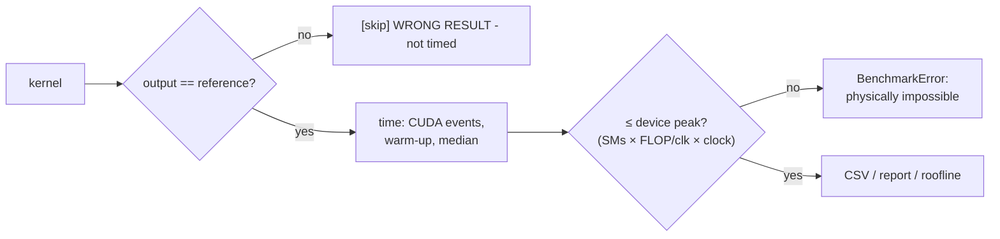

<p align="center">
  <a href="https://github.com/boson316/RTX3050-GPU-Mastery/actions/workflows/ci.yml"></a>
  
  
  
  
  <a href="LICENSE"></a>
</p>

# RTX 3050 GPU Kernel Lab

**Hand-written CUDA and Triton kernels — GEMM, FlashAttention, Transformer blocks, convolution — on a
6 GB laptop GPU, with a verification pipeline that runs without a GPU.**

**Languages:** English · [中文](README.zh-TW.md)

Most GPU-kernel portfolios show speedup charts. This one also shows how the numbers were checked:
every kernel is verified against a reference before it is timed, throughput is
sanity-checked against the hardware's theoretical peak, and the kernel logic is tested in CI on
machines with no GPU at all. Building that pipeline exposed a dozen real bugs and methodology flaws in the first version of this
repo, including two "faster than PyTorch" results that came from kernels doing only part of the work.
They are written up in **[docs/ENGINEERING_LOG.md](docs/ENGINEERING_LOG.md)**.

---

## Highlights

| | What | Where |
|---|---|---|
| ⚡ | **FlashAttention forward** in CUDA (one query row per thread, K/V tiles in shared memory, online softmax with `exp2`, causal tile skipping) and in Triton (autotuned, `tl.dot` on Tensor Cores) | [`flash_attention_simple/`](flash_attention_simple), [`triton_kernels/flash_attention/`](triton_kernels/flash_attention) |
| 🧮 | **Tensor Core GEMM with WMMA**: a 64×64×32 shared-memory block tile, 4 warps × 2×2 fragments, 128-bit copies, padded shared memory, reported as **% of cuBLAS** | [`cuda_roadmap/level4_tensor_core/`](cuda_roadmap/level4_tensor_core) |
| 🔗 | **Kernel fusion**: Triton linear layer with fused bias + GELU epilogue (the MLP is 2 launches), online softmax (2 passes instead of 3), Welford LayerNorm, conv as 9 vectorised outer products | [`triton_kernels/`](triton_kernels), [`gpu_kernels/transformer/`](gpu_kernels/transformer) |
| 🧪 | **GPU-free verification in CI**: the Triton interpreter runs the real kernels on the CPU, and a **CUDA execution-model emulator** (threads + `std::barrier` for `__syncthreads`, per-warp exchange for `__shfl_xor_sync`) runs the real `__global__` code and turns barrier divergence into a deadlock | [`tests/`](tests) |
| 📈 | **Roofline with device-derived peaks** (SMs × FLOPs/clk × clock from NVML). cuBLAS reaches 94 % of the Tensor Core roof at 2048³ | [`profiling/`](profiling), [`benchmarks/gpu_specs.py`](benchmarks/gpu_specs.py) |
| 🐛 | **Engineering log**: data race, two deadlocks, an out-of-bounds cuBLAS call, a transposed WMMA operand, 4 masking bugs and unfair baselines, each with root cause, fix and regression test | [`docs/ENGINEERING_LOG.md`](docs/ENGINEERING_LOG.md) |

---

## Correctness first



| Check | Runs on | Covers |
|---|---|---|
| `pytest` with `TRITON_INTERPRET=1` | CI, CPU | all Triton kernels vs PyTorch: odd shapes, non-power-of-2 `head_dim`, causal (46 cases) |
| `tests/cuda_emulation/run_all.sh` | CI, CPU | CUDA FlashAttention, softmax, LayerNorm, bias+GELU, conv3x3 vs naive references (27 cases) |
| `nvcc -arch=sm_86 --Werror all-warnings` | CI | every `.cu` file |
| self-verifying CUDA binaries (`VERIFY_*=PASS`) | GPU | all CUDA roadmap kernels incl. WMMA, vs a CPU reference |
| `bench_utils.measure()` | GPU | every benchmark: verify → time → plausibility check |

---

## What's inside

| Module | Contents | Key techniques |
|---|---|---|
| [`cuda_roadmap/`](cuda_roadmap) | 11 self-verifying CUDA benchmarks, Levels 1–4 | coalescing, bank conflicts (`[32][33]` transpose), warp-shuffle reduction, fusion, grid-stride + occupancy API, WMMA |
| [`triton_kernels/`](triton_kernels) | matmul, linear / QKV / MLP, softmax, LayerNorm, GELU, conv3x3, FlashAttention | grouped program order for L2 reuse, `num_stages` pipelining, fused epilogues, autotuning |
| [`flash_attention_simple/`](flash_attention_simple) | CUDA FlashAttention (PyTorch extension + standalone) | online softmax, register-resident accumulators, documented register budget (215 regs, 0 spills) |
| [`gpu_kernels/transformer/`](gpu_kernels/transformer) | QKV, softmax, LayerNorm, GELU, MLP as a PyTorch CUDA extension | row-major cuBLAS via `Yᵀ = WᵀXᵀ`, fused bias+GELU epilogue, Welford statistics |
| [`extension/`](extension) | 3×3 conv (C_in = 1, C_out = 32) as a PyTorch extension | 18×18 halo tile reused for 32 channels × 9 taps |
| [`benchmarks/`](benchmarks) | verified benchmark harness, device-peak query | CUDA events, correctness gate, plausibility ceiling |
| [`profiling/`](profiling) | roofline analysis, Nsight Compute / Systems scripts | arithmetic intensity vs. measured throughput |
| [`tests/`](tests) | Triton interpreter tests, CUDA CPU emulator | see above |

---

## Results

**GPU:** NVIDIA GeForce RTX 3050 6GB Laptop (GA107, Ampere, sm_86). Run `python benchmarks/gpu_specs.py`
to print SM count, clocks and theoretical peaks for your exact SKU; the roofline and the
plausibility check use these values.

### Roofline


What the plot says:
- **GEMM is compute-bound and cuBLAS is near the roof** (80–94 % at 1024³–2048³). That's the bar the WMMA kernel is measured against.
- **Softmax / LayerNorm / GELU sit at AI ≈ 1–2 FLOP/byte**, so they are purely bandwidth-bound and reach only ~40 % of the DRAM roof at this size (6 MB working set). The win there is fusion, not more FLOPs, which is why the MLP fuses bias + GELU into the GEMM epilogue.
- **cuDNN reaches only 13–23 % of the memory roof for a C_in = 1 convolution**, so this is a shape where a specialised kernel has room to win.

### Verified measurements (FP16)

| Kernel | Shape | PyTorch | Triton (this repo) |
|---|---|---|---|
| Softmax | 2048 × 768 | 0.064 ms · 98 GB/s | 0.091 ms · 69 GB/s |
| LayerNorm | 2048 × 768 | 0.063 ms · 100 GB/s | **0.062 ms · 101 GB/s** |
| GELU | 1.57 M elements | 0.071 ms · 88 GB/s | **0.055 ms · 115 GB/s** |
| Matmul (cuBLAS) | 2048³ | 1.15 ms · 14.9 TFLOPS | re-run pending |
| SDPA | B2 H8 S512 D64 | 0.105 ms · 10.2 TFLOPS | re-run pending |

> **Re-run pending.** Results for kernels that were fixed (Triton FlashAttention / matmul / conv / MLP,
> all CUDA extension kernels, the WMMA GEMM) were removed because the old numbers came from code
> that computed wrong results or has since changed. Regenerate everything, verified, with
> `scripts/reproduce_all.sh` (or `.bat`).

---

## Quick start

```bash
git clone https://github.com/boson316/RTX3050-GPU-Mastery.git && cd RTX3050-GPU-Mastery
pip install torch==2.6.0 torchvision==0.21.0 --index-url https://download.pytorch.org/whl/cu124
pip install -r requirements.txt "triton==3.2.*" pytest nvidia-ml-py      # Windows: triton-windows==3.2.*

pytest -q                              # kernel correctness (GPU, or CPU via TRITON_INTERPRET=1)
tests/cuda_emulation/run_all.sh        # CUDA kernel logic on the CPU (needs g++ >= 11)
python benchmarks/gpu_specs.py         # theoretical peaks of this GPU
scripts/reproduce_all.sh               # everything: verify, benchmark, report, roofline
```

| Task | Command |
|---|---|
| CUDA roadmap | `cd cuda_roadmap && ./build.sh && cd .. && python cuda_roadmap/run_benchmarks.py` |
| Triton kernels | `python -m triton_kernels.run_benchmarks` |
| FlashAttention (CUDA vs Triton vs SDPA) | `python benchmarks/benchmark_attention.py` |
| Transformer blocks | `python benchmarks/benchmark_transformer.py` |
| Matmul / conv | `python benchmarks/benchmark_matmul.py`, `python benchmarks/benchmark_conv.py` |
| Full report | `python tools/performance_dashboard.py --skip-mnist` → [`benchmarks/performance_report.md`](benchmarks/performance_report.md) |
| Roofline | `python profiling/roofline_analysis.py` |
| Nsight | `python profiling/run_nsight_profiling.py` ([guide](docs/nsight_profiling_guide.md)) |

Windows: build the CUDA extensions from an *x64 Native Tools Command Prompt for VS*.

---

## Learning material

- [`tutorials/`](tutorials): CUDA basics → shared memory → tiling → Triton → FlashAttention → Transformer kernels
- [`docs/`](docs/INDEX.md): memory hierarchy, optimisation guide, roofline, Nsight, per-level kernel notes
- [`notebooks/`](notebooks): interactive walk-throughs

## Project layout

```
cuda_roadmap/            Level 1-4 CUDA benchmarks + common/bench_common.cuh (timing + verification)
triton_kernels/          Triton kernels (matmul, linear/qkv/mlp, softmax, layernorm, gelu, conv, flash_attention)
flash_attention_simple/  CUDA FlashAttention: flash_attention_kernel.cuh, PyTorch extension, standalone
gpu_kernels/             transformer CUDA extension + small standalone kernels
extension/               conv3x3 PyTorch extension (conv3x3_kernel.cuh)
benchmarks/              verified benchmark harness (bench_utils.py), gpu_specs.py, results CSV
profiling/               roofline analysis, Nsight scripts and reports
tests/                   Triton interpreter tests, cuda_emulation/ (CPU emulator for CUDA kernels)
docs/ tutorials/ notebooks/
```

## License

[MIT](LICENSE)
