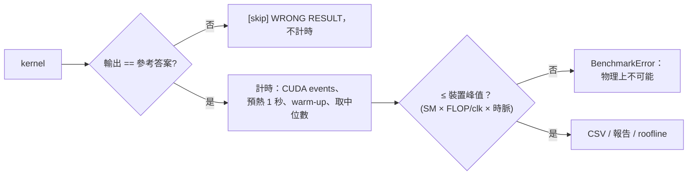
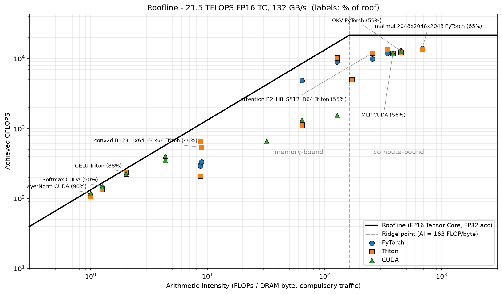
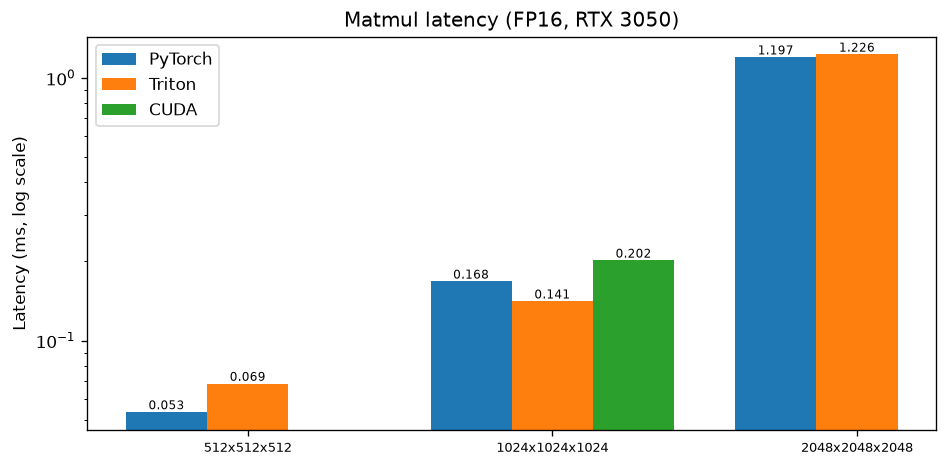
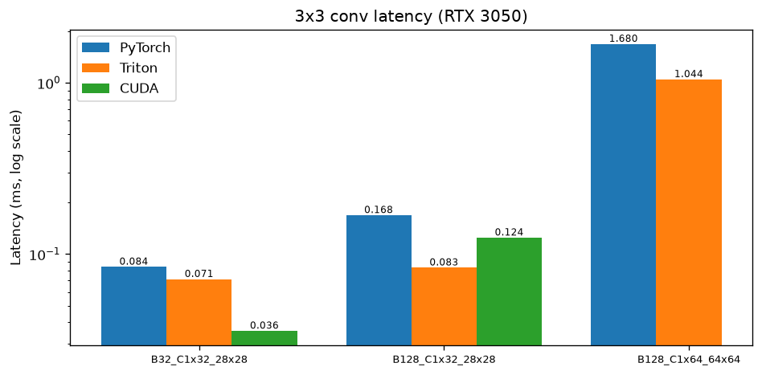
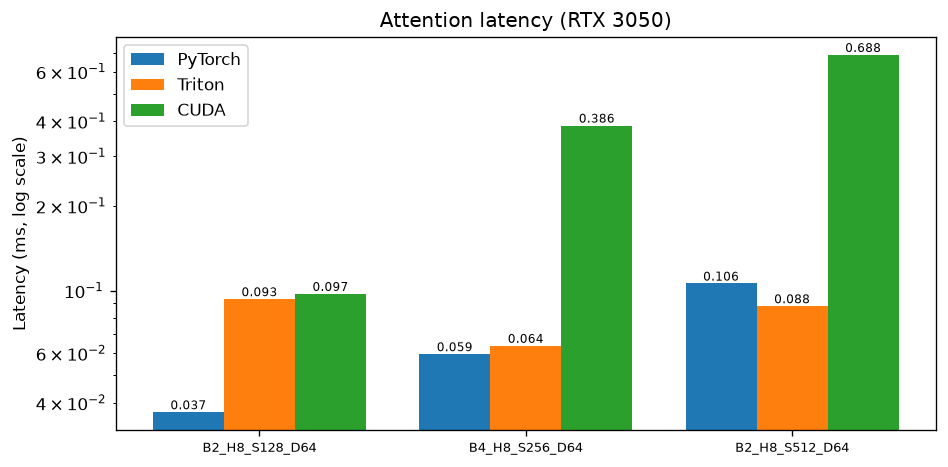
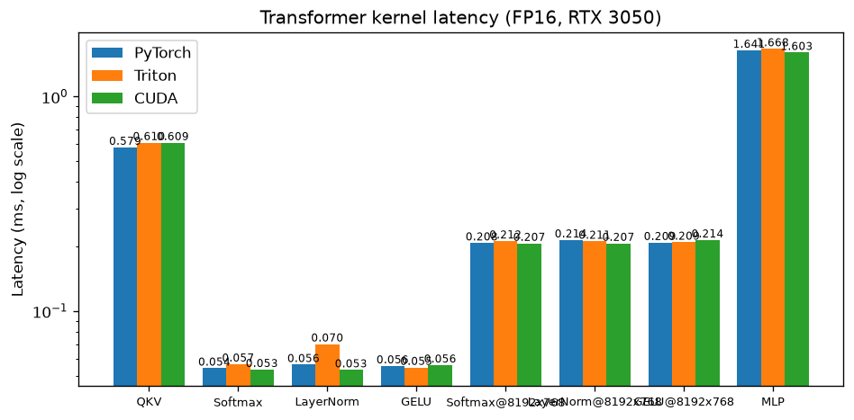

<p align="center">
  <a href="https://github.com/boson316/RTX3050-GPU-Mastery/actions/workflows/ci.yml"></a>
  
  
  
  
  <a href="LICENSE"></a>
</p>

# RTX 3050 GPU Kernel Lab

**在 6GB 筆電 GPU 上手寫 CUDA 與 Triton kernel（GEMM、FlashAttention、Transformer 區塊、卷積），並附上一套不需要 GPU 也能執行的驗證流程。**

**Languages:** [English](README.md) · 中文

大多數 GPU kernel 作品集只放加速比的圖。這個專案也呈現這些數字是怎麼被檢驗的：每個 kernel 計時前都先跟參考答案比對，量到的吞吐量會跟硬體理論峰值做合理性檢查，kernel 的邏輯則在沒有 GPU 的 CI 機器上測試。建立這套流程的過程中，找出了第一版裡十幾個真正的 bug 和方法論問題，其中包含兩個「比 PyTorch 快」的結果，事後證明都是因為 kernel 少算了一部分。完整紀錄在 **[docs/ENGINEERING_LOG.md](docs/ENGINEERING_LOG.md)**。

---

## 亮點

| | 內容 | 位置 |
|---|---|---|
| ⚡ | **FlashAttention forward**：CUDA 版（每個 thread 負責一個 query row、K/V tile 放在 shared memory、用 `exp2` 做 online softmax、causal 時跳過整塊 tile）和 Triton 版（autotune、`tl.dot` 走 Tensor Core） | [`flash_attention_simple/`](flash_attention_simple)、[`triton_kernels/flash_attention/`](triton_kernels/flash_attention) |
| 🧮 | **WMMA Tensor Core GEMM**：64×64×32 shared-memory block tile、4 個 warp 各算 2×2 fragment、128-bit 搬移、shared memory padding。實測：**2048³ 為 cuBLAS 的 79～87%**；1024³ 中位數 81%，但範圍很大（65.6～109.6%）（以上為 v2.0；v2.1 探測在 2048³ 跑 10 次為 76～83%，當時有背景程式佔用 GPU） | [`cuda_roadmap/level4_tensor_core/`](cuda_roadmap/level4_tensor_core) |
| 🔗 | **Kernel fusion**：Triton linear 把 bias + GELU 融合進 epilogue（MLP 只需 2 次 launch）、online softmax（讀 2 次而不是 3 次）、Welford LayerNorm、把卷積寫成 9 次向量化 outer product | [`triton_kernels/`](triton_kernels)、[`gpu_kernels/transformer/`](gpu_kernels/transformer) |
| 🧪 | **CI 上不需要 GPU 的驗證**：Triton interpreter 在 CPU 上執行真正的 kernel；自製的 **CUDA 執行模型模擬器**用 `std::thread` 跑每個 thread、用 `std::barrier` 模擬 `__syncthreads`、用 per-warp 交換區模擬 `__shfl_xor_sync`，直接執行真正的 `__global__` 程式碼。如果有 thread 沒走到 barrier，模擬器會直接死鎖，bug 藏不住 | [`tests/`](tests) |
| 📈 | **由裝置推導峰值的 Roofline**：SM 數 × 每 clock FLOPs × NVML 查到的時脈。cuBLAS 在 2048³ 達到 NVML 最大時脈 roof 的 67%，以實際維持的時脈計算則是 81% | [`profiling/`](profiling)、[`benchmarks/gpu_specs.py`](benchmarks/gpu_specs.py) |
| 🐛 | **工程日誌**：data race、兩個死鎖、cuBLAS 越界讀取、WMMA 運算元被轉置、4 個 mask bug、不公平的 baseline，以及在真實 GPU 上新發現的 5 個 bug。每個都附根本原因、修法和回歸測試 | [`docs/ENGINEERING_LOG.md`](docs/ENGINEERING_LOG.md) |

---

## 正確性優先



| 檢查 | 執行環境 | 涵蓋範圍 |
|---|---|---|
| `pytest` 搭配 `TRITON_INTERPRET=1` | CI，CPU | 所有 Triton kernel 對照 PyTorch：奇數形狀、非 2 次方的 `head_dim`、causal（46 個案例） |
| `tests/cuda_emulation/run_all.sh` | CI，CPU | CUDA FlashAttention、softmax、LayerNorm、bias+GELU、conv3x3 對照 naive 參考實作（39 個案例） |
| `nvcc -arch=sm_86 --Werror all-warnings` | CI | 每一個 `.cu` 檔 |
| `pytest`（GPU） | RTX 3050 | 編譯後的 Triton kernel（FP32 與 FP16）、autotune 版本、三個 PyTorch CUDA extension、計時工具（129 個案例） |
| 自我驗證的 CUDA 執行檔（`VERIFY_*=PASS`） | GPU | 所有 roadmap kernel（含 WMMA）對照 CPU 參考答案 |
| `bench_utils.measure()` | GPU | 每個 benchmark：驗證 → 計時 → 合理性檢查 |

---

## 內容

| 模組 | 內容 | 關鍵技術 |
|---|---|---|
| [`cuda_roadmap/`](cuda_roadmap) | 11 個會自我驗證的 CUDA benchmark，Level 1–4 | coalescing、bank conflict（`[32][33]` 轉置）、warp shuffle reduction、fusion、grid-stride + occupancy API、WMMA |
| [`triton_kernels/`](triton_kernels) | matmul、linear / QKV / MLP、softmax、LayerNorm、GELU、conv3x3、FlashAttention | 為 L2 重用設計的 grouped program order、`num_stages` pipelining、fused epilogue、autotune |
| [`flash_attention_simple/`](flash_attention_simple) | CUDA FlashAttention（PyTorch extension + standalone） | online softmax、累加器常駐 register、有記錄的 register 預算（215 regs、0 spill） |
| [`gpu_kernels/transformer/`](gpu_kernels/transformer) | QKV、softmax、LayerNorm、GELU、MLP 的 PyTorch CUDA extension | 用 `Yᵀ = WᵀXᵀ` 呼叫 row-major cuBLAS、fused bias+GELU epilogue、Welford 統計 |
| [`extension/`](extension) | 3×3 卷積（C_in = 1、C_out = 32）PyTorch extension | 18×18 halo tile 給 32 個 channel × 9 個 tap 重用 |
| [`benchmarks/`](benchmarks) | 有驗證的 benchmark 框架、裝置峰值查詢 | CUDA events、正確性閘門、合理性上限 |
| [`profiling/`](profiling) | Roofline 分析、Nsight Compute / Systems 腳本 | 算術強度 vs 實測吞吐量 |
| [`tests/`](tests) | Triton interpreter 測試、CUDA CPU 模擬器 | 見上方 |

---

## 結果

**GPU：** NVIDIA GeForce RTX 3050 6GB Laptop（Ampere、sm_86），20 個 SM、96-bit 匯流排、43W，插電並使用最佳效能模式。
**軟體：** 驅動程式 610.62、CUDA 12.4、PyTorch 2.6.0、Triton 3.2.0、MSVC 14.50。完整環境見 [`results/v2/environment.md`](results/v2/environment.md)。

表格每一格是**延遲中位數，單位 ms（3 輪的最小值～最大值）**。每個 kernel 都先通過正確性檢查才計時。原始 log 和 CSV 在 [`results/v2/`](results/v2)，摘要見 [`results/v2/SUMMARY.md`](results/v2/SUMMARY.md)。

| 指標 | 數值 |
|---|---|
| NVML 最大時脈的峰值 | 21.5 TFLOPS @ 2100 MHz |
| 負載下 SM 時脈中位數 | 1747 MHz |
| 持續時脈的峰值 | 17.9 TFLOPS |
| DRAM 峰值頻寬 | 132 GB/s |

Roof 用兩種時脈呈現，因為 2100 MHz 是 NVML 回報的最大值，而這台 43W 筆電在這些負載下實際約為 1747 MHz。

### Roofline



圖上使用 NVML 最大時脈的 roof，每類 kernel 只標一個點，資料來自 v2.1 最後一輪。下表另外列出以持續時脈計算的 roof。QKV、MLP、softmax、LayerNorm、GELU 這幾列是 v2.1（3 輪中位數），其餘是 v2.0。

| Kernel | 受限於 | 佔 NVML 最大時脈屋頂 % (PyTorch / Triton / CUDA) | 佔持續時脈屋頂 % (PyTorch / Triton / CUDA) |
|---|---|---|---|
| GEMM 2048³ | 運算 | 67 / 65 / — | 81 / 78 / — |
| QKV | 運算 | 57 / 57 / 59 | 69 / 68 / 71 |
| MLP | 運算 | 55 / 55 / 56 | 66 / 66 / 67 |
| Attention S512 | 運算 | 48 / 57 / 9 | 57 / 68 / 9 |
| Conv B128 64×64 | 記憶體 | 29 / 47 / — | 29 / 47 / — |
| Conv B128 28×28 | 記憶體 | 26 / 44 / 70 | 26 / 44 / 70 |
| Softmax | 記憶體 | 87 / 82 / 90 | 87 / 82 / 90 |
| LayerNorm | 記憶體 | 85 / 71 / 90 | 85 / 71 / 90 |
| GELU | 記憶體 | 88 / 88 / 85 | 88 / 88 / 85 |

- **GEMM 受運算能力限制，cuBLAS 已接近這張卡能維持的上限。** 自訂 kernel 的空間很小：Triton 在 2048³ 與它打平，CUDA 在 1024³ 也落在相近範圍。
- **Softmax、LayerNorm、GELU 受頻寬限制。** PyTorch 已達 DRAM roof 的 85～88%，自訂 kernel 很難贏太多。v2.1 的 warp-per-row 路徑把 CUDA 的 softmax 和 LayerNorm 從 50% 和 43% 拉到 90%，與 PyTorch 同級。
- **cuDNN 處理這些 C_in = 1 的卷積時只用到記憶體 roof 的 26～29%**，所以專用 kernel 在這裡才有機會勝出。

### 量測結果

QKV、MLP、softmax、LayerNorm、GELU 這幾列是 v2.1，下方另附 v2.0 當對照。GEMM、卷積和 attention 各列是 v2.0（這些 kernel 沒有改動，未重跑）。精度說明：GEMM 和 Transformer 各列都是 FP16，PyTorch 和 Triton 的卷積與 attention 也是 FP16。**CUDA 的卷積和 attention kernel 使用 FP32 儲存**，資料量是兩倍，attention kernel 也是跑在 CUDA core 而不是 Tensor Core。CUDA 的 GELU 實作 tanh 形式，另外兩者實作精確形式，各自對照自己的定義驗證。

| Kernel | 形狀 | PyTorch | Triton | CUDA |
|---|---|---|---|---|
| GEMM | 512×512×512 | 0.053 (0.053–0.066) · 5.03 TFLOPS | 0.069 (0.060–0.069) · 3.92 TFLOPS | — |
| GEMM | 1024×1024×1024 | 0.168 (0.168–0.184) · 12.80 TFLOPS | 0.141 (0.138–0.155) · 15.23 TFLOPS | 0.202 (0.201–0.222) · 10.65 TFLOPS |
| GEMM | 2048×2048×2048 | 1.197 (1.178–1.205) · 14.36 TFLOPS | 1.226 (1.210–1.233) · 14.01 TFLOPS | — |
| QKV | 2048×768→2304 | 0.579 (0.542–0.661) · 12.51 TFLOPS | 0.610 (0.609–0.694) · 11.89 TFLOPS | 0.609 (0.596–0.668) · 11.90 TFLOPS |
| MLP | 2048×768→3072→768 | 1.641 (1.617–1.691) · 11.78 TFLOPS | 1.668 (1.622–1.681) · 11.59 TFLOPS | 1.603 (1.595–1.663) · 12.06 TFLOPS |
| Softmax | 2048×768 | 0.054 (0.054–0.054) · 116 GB/s | 0.057 (0.055–0.064) · 111 GB/s | 0.053 (0.053–0.054) · 118 GB/s |
| LayerNorm | 2048×768 | 0.056 (0.056–0.056) · 112 GB/s | 0.070 (0.068–0.085) · 90 GB/s | 0.053 (0.053–0.054) · 118 GB/s |
| GELU | 1572864 | 0.056 (0.055–0.056) · 113 GB/s | 0.055 (0.054–0.056) · 115 GB/s | 0.056 (0.056–0.056) · 112 GB/s |
| Softmax | 8192×768 | 0.208 (0.207–0.222) · 121 GB/s | 0.212 (0.211–0.226) · 119 GB/s | 0.207 (0.206–0.207) · 122 GB/s |
| LayerNorm | 8192×768 | 0.214 (0.214–0.215) · 117 GB/s | 0.211 (0.211–0.215) · 119 GB/s | 0.207 (0.206–0.212) · 122 GB/s |
| GELU | 6291456 | 0.209 (0.207–0.219) · 121 GB/s | 0.209 (0.208–0.219) · 120 GB/s | 0.214 (0.214–0.231) · 117 GB/s |
| Conv 3×3 | B32_C1x32_28x28 | 0.084 (0.041–0.086) · 0.15 TFLOPS | 0.071 (0.067–0.103) · 0.17 TFLOPS | 0.036 (0.035–0.036) · 0.35 TFLOPS |
| Conv 3×3 | B128_C1x32_28x28 | 0.168 (0.168–0.171) · 0.30 TFLOPS | 0.083 (0.076–0.102) · 0.60 TFLOPS | 0.124 (0.124–0.125) · 0.40 TFLOPS |
| Conv 3×3 | B128_C1x64_64x64 | 1.680 (1.669–1.710) · 0.34 TFLOPS | 1.044 (1.019–1.049) · 0.54 TFLOPS | — |
| Attention | B2_H8_S128_D64 | 0.037 (0.016–0.049) · 1.81 TFLOPS | 0.093 (0.071–0.128) · 0.72 TFLOPS | 0.097 (0.097–0.107) · 0.69 TFLOPS |
| Attention | B4_H8_S256_D64 | 0.059 (0.058–0.060) · 9.02 TFLOPS | 0.064 (0.060–0.141) · 8.42 TFLOPS | 0.386 (0.385–0.405) · 1.39 TFLOPS |
| Attention | B2_H8_S512_D64 | 0.106 (0.105–0.107) · 10.13 TFLOPS | 0.088 (0.087–0.097) · 12.19 TFLOPS | 0.688 (0.678–0.691) · 1.56 TFLOPS |






**v2.0 對照**（相同的列，[`results/v2/csv/`](results/v2/csv)）：

| Kernel | 形狀 | PyTorch | Triton | CUDA |
|---|---|---|---|---|
| QKV | 2048×768→2304 | 0.545 (0.537–0.609) · 13.30 TFLOPS | 0.587 (0.546–0.674) · 12.36 TFLOPS | 0.675 (0.674–0.775) · 10.74 TFLOPS |
| MLP | 2048×768→3072→768 | 1.612 (1.584–1.708) · 11.99 TFLOPS | 1.634 (1.630–1.698) · 11.83 TFLOPS | 1.681 (1.679–1.726) · 11.50 TFLOPS |
| Softmax | 2048×768 | 0.054 (0.054–0.055) · 116 GB/s | 0.057 (0.057–0.060) · 110 GB/s | 0.094 (0.093–0.099) · 67 GB/s |
| LayerNorm | 2048×768 | 0.056 (0.056–0.077) · 112 GB/s | 0.067 (0.065–0.073) · 94 GB/s | 0.111 (0.110–0.118) · 57 GB/s |
| GELU | 1572864 | 0.056 (0.055–0.056) · 113 GB/s | 0.054 (0.054–0.060) · 116 GB/s | 0.056 (0.056–0.057) · 112 GB/s |

**量測條件和 v2.0 不同。** v2.0 開始時 GPU 記憶體用量是 0 MiB；v2.1 量測時有背景程式掛在 GPU 上（閒置時 532～551 MiB，[`idle_background.csv`](results/v2_1/logs/idle_background.csv)，選擇不關閉），插電與最佳效能模式則相同。沒有改動的 PyTorch 列就是對照組：softmax、LayerNorm、GELU 最多只變動 0.4%，但受運算能力限制的 QKV 慢了 6.3%，MLP 慢了 1.8%。所以 v2.1 的 kernel 要和同一輪的 PyTorch 比，不要和 v2.0 的絕對數字比。所有比值見 [`aggregate.log`](results/v2_1/logs/aggregate.log)。

**v2.1 改變了什麼（CUDA 對同一輪的 PyTorch）：**
- **Softmax 和 LayerNorm：達標。** 都是 118 GB/s，超過 100 GB/s 的目標，v2.0 是 67 和 57 GB/s。v2.0 比 PyTorch 慢 53～97%；v2.1 的 softmax 快 1.1～1.8%，LayerNorm 快 5.0～5.9%。關鍵是用 128-bit 讀取、每列只讀一次 DRAM，現在三者都頂到頻寬牆。
- **MLP：達標。** 比 PyTorch 快 1.4～2.3%，v2.0 是慢 1.1～6.0%。
- **QKV：接近很多，但不能說打平。** 差距從 23.8～27.4% 降到 1.1～9.9%（中位數從 0.14 ms 降到 0.03 ms），可見獨立的 bias pass 確實是主因。範圍有重疊，但 3 輪都是 CUDA 較慢，也沒達到 0.545 ms 的目標。剩下的差距沒有量到原因；MLP 呼叫兩次 cublasLt 仍贏過 PyTorch，所以看起來不太像 cublasLt 每次呼叫的開銷，但這點沒有實際測試。

**自訂 kernel 仍然較慢的地方，以及原因：**
- S = 512 時 CUDA attention 比 Triton 慢約 8 倍，比較的是 CUDA core 上的 FP32 和 Tensor Core 上的 FP16。
- PyTorch 在 512³ 的 GEMM 較快，SDPA 在 S = 128、256 的 attention 較快，但這兩個 S 的結果已接近下面所說的計時極限。

**自訂 kernel 較快的地方：** CUDA 的 softmax、LayerNorm、MLP（快幾個百分點）、B = 32 的 CUDA 卷積、B = 128 的 Triton 卷積、1024³ 的 Triton GEMM，以及 S = 512 的 Triton attention。

**2048×768 的逐列 kernel 落在 Triton 的 launch 下限上**（約 0.055 ms，見下方「限制」），所以那幾格 Triton 的數字主要反映 Python 的 launch 開銷。到了 8192×768，這個下限就不再重要：三個 kernel 的 Triton 都和 CUDA 相差 2.6% 以內（LayerNorm 在 2048×768 時還慢 32%），全部達到 117～122 GB/s，也就是頻寬牆。Triton 的 kernel 本身在這裡沒有問題。

### 長序列 FlashAttention（B=1、H=8、D=64）

**FP16**

| S | 實作 | 延遲（ms） | TFLOPS | 額外顯存（MiB） | 相對 FP64 最大誤差 |
|---|---|---|---|---|---|
| 1024 | SDPA | 0.212 (0.210–0.223) | 10.15 | 1.0 | 3.642e-04 |
| 1024 | Triton | 0.174 (0.173–0.192) | 12.34 | 1.0 | 3.642e-04 |
| 2048 | SDPA | 0.855 (0.771–0.907) | 10.05 | 2.0 | 2.649e-04 |
| 2048 | Triton | 0.633 (0.621–0.666) | 13.57 | 2.0 | 2.649e-04 |
| 4096 | SDPA | 3.300 (3.209–3.333) | 10.41 | 4.0 | 1.029e-04 |
| 4096 | Triton | 2.447 (2.408–2.464) | 14.04 | 4.0 | 1.029e-04 |

**IEEE FP32**

| S | 實作 | 延遲（ms） | TFLOPS | 額外顯存（MiB） | 相對 FP64 最大誤差 |
|---|---|---|---|---|---|
| 1024 | SDPA | 1.336 (1.327–1.435) | 1.61 | 2.0 | 1.104e-06 |
| 1024 | Triton | 1.526 (1.494–1.531) | 1.41 | 2.0 | 9.730e-07 |
| 1024 | CUDA | 1.291 (1.270–1.322) | 1.66 | 2.0 | 8.538e-07 |
| 2048 | SDPA | 4.769 (4.754–4.805) | 1.8 | 4.0 | 7.772e-07 |
| 2048 | Triton | 5.754 (5.709–5.755) | 1.49 | 4.0 | 4.165e-07 |
| 2048 | CUDA | 4.858 (4.830–4.914) | 1.77 | 4.0 | 5.634e-07 |
| 4096 | SDPA | 20.397 (20.380–20.463) | 1.68 | 8.0 | 4.184e-07 |
| 4096 | Triton | 21.328 (21.228–21.356) | 1.61 | 8.0 | 4.313e-07 |
| 4096 | CUDA | 17.600 (17.395–17.615) | 1.95 | 8.0 | 5.905e-07 |

**TF32**

| S | 實作 | 延遲（ms） | TFLOPS | 額外顯存（MiB） | 相對 FP64 最大誤差 |
|---|---|---|---|---|---|
| 1024 | Triton | 0.375 (0.365–0.391) | 5.72 | 2.0 | 1.367e-03 |
| 2048 | Triton | 1.357 (1.350–1.361) | 6.33 | 4.0 | 1.767e-03 |
| 4096 | Triton | 5.220 (5.097–5.267) | 6.58 | 8.0 | 5.593e-04 |

- **顯存：** 每種實作都只需要輸出緩衝區，傳統寫法在 S = 4096 時要 1024 MiB（v2.0，[`results/v2/tables_zh.md`](results/v2/tables_zh.md)）。但這裡 PyTorch 的 SDPA 本身就避開了完整矩陣（後端選擇是 `EFFICIENT_ATTENTION`），所以省下的是相對傳統寫法，不是相對 SDPA。
- **FP16（實際模型用的）：Triton 比 SDPA 快 18～26%**，誤差到 4 位有效數字都相同。
- **IEEE FP32（v2.0 無法公平比較的項目）：** CUDA kernel 在 S = 1024 比 SDPA 快 3.4%，S = 2048 慢 1.9%，**S = 4096 快 13.7%**（17.6 對 20.4 ms）。`precision="ieee"` 的 Triton 在這組最慢，比 SDPA 慢 4.6～20.7%，誤差為 4.2e-07～9.7e-07（目標是 ≤1e-4）。
- **v2.0 的「Triton 快 4 倍」其實是 TF32 對 IEEE：** 同一個 Triton kernel 換成 IEEE 模式就慢 4.1～4.2 倍，完全解釋了這個差距。
- **在這裡量到的每一項，TF32 都輸給 FP16：** 慢 2.1～2.2 倍、顯存兩倍、誤差也較大（5.6e-04～1.8e-03 對 1.0e-04～3.6e-04）。它唯一可能的優勢是 FP32 的指數範圍，這個隨機輸入測試並沒有用到。它的誤差為何比 FP16 大，沒有量測。

### WMMA tiled GEMM 與 cuBLAS（FP16）

| 指標 | 中位數 | 最小 | 最大 | 次數 |
|---|---|---|---|---|
| 1024³ WMMA tiled（GFLOPS） | 9605.5 | 7410.4 | 10699.8 | 20 |
| 1024³ cuBLAS（GFLOPS） | 11077.9 | 8974.2 | 11397.6 | 20 |
| 1024³ WMMA 佔 cuBLAS（%） | 85.5 | 66.5 | 115.2 | 20 |
| 2048³ WMMA tiled（GFLOPS） | 11635.0 | 10901.4 | 11792.4 | 10 |
| 2048³ cuBLAS（GFLOPS） | 14321.1 | 14005.5 | 14413.4 | 10 |
| 2048³ WMMA 佔 cuBLAS（%） | 81.2 | 75.6 | 83.0 | 10 |

v2.0 較早的數字：2048³ WMMA 為 cuBLAS 的 79.1～86.5%（6 次）；1024³ 中位數 81.4%，範圍 65.6～109.6%（12 次）。以上每一次都通過驗證。

**1024³ 的快慢兩組，由 [`tools/gpu_state_probe.py`](tools/gpu_state_probe.py) 以 8058 GFLOPS 分開**（[`log`](results/v2_1/logs/gpu_state_probe_1024.log)）：

| 狀態 | 慢群 | 快群 |
|---|---|---|
| 次數 | 7 | 13 |
| `WMMA_TILED_GFLOPS` | 7570.9 | 10295.9 |
| `WMMA_NAIVE_GFLOPS` | 2297.0 | 3281.9 |
| `CUBLAS_GFLOPS` | 11155.1 | 10988.8 |
| `sm_mhz_median` | 990.0 | 990.0 |
| `mem_mhz_median` | 5501.0 | 5501.0 |
| `power_w_median` | 9.0 | 7.7 |
| `temp_c_median` | 65.0 | 65.0 |
| `pstates` | P0, P0/P3, P0/P3/P5, P0/P5 | P0, P0/P3, P0/P5, P3 |
| `throttle` | none, sw_power_cap+sw_thermal | none, sw_power_cap+sw_thermal |

**沒有任何記錄到的狀態變數能分開這兩組。** SM 時脈、記憶體時脈、溫度和功耗都差不多，P-state 和降頻原因在兩組都有出現。2048³ 則完全沒有分群（10.9～11.8 TFLOPS），10 次都碰到 `sw_power_cap`（[`log`](results/v2_1/logs/gpu_state_probe_2048.log)）。

**證據不支持 v2.0 提出的「整次執行的 GPU 狀態」假設**（[`analyze_probe.log`](results/v2_1/logs/analyze_probe.log)）：
- 它其實不是兩個緊密的群：7 次落在 7410～7626 GFLOPS，3 次在 8490～9362 之間，10 次落在 9849～10700。
- WMMA naive 和 WMMA tiled 同步變動（r = +0.99），但緊接著在同一個行程、用同一批緩衝區計時的 cuBLAS 沒有（r = −0.36；慢組中位數 11155 GFLOPS，快組 10989）。cuBLAS 自己變慢的 3 次（8974～9279 GFLOPS）都出現在 WMMA 快的那幾次。

**原因仍然未知，這個探測工具也有極限：** 它每 20 ms 取樣一次，而這些 kernel 只跑約 0.2 ms。取樣到的時脈中位數 990 MHz 最多只能到 10136 GFLOPS，但 cuBLAS 量到 11398（至少要 1113 MHz），代表這些樣本並沒有反映 kernel 執行當下的時脈，所以不能排除這麼短暫的狀態變化。下一步該查的是同一行程內只影響這兩個 WMMA kernel 的因素，例如緩衝區落在 DRAM 的位置，但這只是尚未驗證的想法。請不要把這個 benchmark 的單次結果當成答案。

CUDA roadmap 的 11 個 benchmark 全部通過驗證，結果見 [`cuda_roadmap/results.md`](cuda_roadmap/results.md)。不是每個「最佳化」都有效：bank conflict 的 padding 量到 1.00x，persistent grid-stride kernel 是 0.97x。

### 這些數字的限制

- **發送下限。** 低於下表時間的量測，反映的是主機端發送成本而不是 kernel 本身。Triton 的 Python 發送路徑下限最高，所以它 0.1 ms 以下的結果大多量到的是這個下限：

| 實作 | 發送下限（ms） |
|---|---|
| PyTorch | 0.0112 |
| Triton | 0.0553 |
| CUDA | 0.0092 |

- **雜訊。** 修正計時方式後，約 0.1 ms 以下的 kernel 在不同輪之間仍有變化，所以表格都附上範圍。
- **只有一台筆電。** 量測受散熱和功耗限制。編譯器也超出 CUDA 12.4 的支援範圍（MSVC 14.50 搭配 `-allow-unsupported-compiler`）。
- **沒有執行 Nsight Compute**，所以瓶頸解釋來自 roofline，不是硬體計數器。

---

## 快速開始

```bash
git clone https://github.com/boson316/RTX3050-GPU-Mastery.git && cd RTX3050-GPU-Mastery
pip install torch==2.6.0 torchvision==0.21.0 --index-url https://download.pytorch.org/whl/cu124
pip install -r requirements.txt "triton==3.2.*" pytest nvidia-ml-py      # Windows：triton-windows==3.2.*

pytest -q                              # kernel 正確性（GPU；沒有 GPU 時需要 CPU 版 torch 和最新版 Triton，與 CI 相同）
tests/cuda_emulation/run_all.sh        # 在 CPU 上驗證 CUDA kernel 邏輯（需要 g++ >= 11）
python benchmarks/gpu_specs.py         # 這張 GPU 的理論峰值
scripts/reproduce_all.sh               # 一次跑完：驗證、benchmark、報告、roofline
```

| 任務 | 指令 |
|---|---|
| CUDA roadmap | `cd cuda_roadmap && ./build.sh && cd .. && python cuda_roadmap/run_benchmarks.py` |
| Triton kernels | `python -m triton_kernels.run_benchmarks` |
| FlashAttention（CUDA vs Triton vs SDPA） | `python benchmarks/benchmark_attention.py` |
| Transformer 區塊 | `python benchmarks/benchmark_transformer.py` |
| Matmul / conv | `python benchmarks/benchmark_matmul.py`、`python benchmarks/benchmark_conv.py` |
| 完整報告 | `python tools/performance_dashboard.py --skip-mnist` → [`benchmarks/performance_report.md`](benchmarks/performance_report.md) |
| Roofline | `python profiling/roofline_analysis.py` |
| Nsight | `python profiling/run_nsight_profiling.py`（[說明](docs/nsight_profiling_guide.md)） |

Windows 上請在 *x64 Native Tools Command Prompt for VS* 裡編譯 CUDA extension。

---

## 學習資源

- [`tutorials/`](tutorials)：CUDA 基礎 → shared memory → tiling → Triton → FlashAttention → Transformer kernels
- [`docs/`](docs/INDEX.md)：記憶體階層、優化指南、roofline、Nsight、各 Level 的 kernel 說明
- [`notebooks/`](notebooks)：互動式範例

## 專案結構

```
cuda_roadmap/            Level 1-4 CUDA benchmark + common/bench_common.cuh（計時 + 驗證）
triton_kernels/          Triton kernels（matmul、linear/qkv/mlp、softmax、layernorm、gelu、conv、flash_attention）
flash_attention_simple/  CUDA FlashAttention：flash_attention_kernel.cuh、PyTorch extension、standalone
gpu_kernels/             transformer CUDA extension + 小型 standalone kernel
extension/               conv3x3 PyTorch extension（conv3x3_kernel.cuh）
benchmarks/              有驗證的 benchmark 框架（bench_utils.py）、gpu_specs.py、結果 CSV
profiling/               roofline 分析、Nsight 腳本與報告
tests/                   Triton interpreter 測試、cuda_emulation/（CUDA kernel 的 CPU 模擬器）
docs/ tutorials/ notebooks/
```

## 授權

[MIT](LICENSE)
