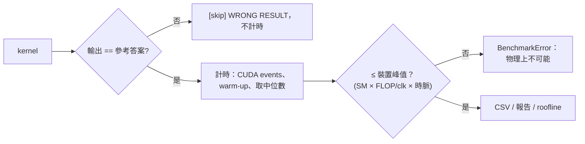

<p align="center">
  <a href="https://github.com/boson316/RTX3050-GPU-Mastery/actions/workflows/ci.yml"></a>
  
  
  
  
  <a href="LICENSE"></a>
</p>

# RTX 3050 GPU Kernel Lab

**在 6GB 筆電 GPU 上手寫 CUDA 與 Triton kernel（GEMM、FlashAttention、Transformer 區塊、卷積），並附上一套不需要 GPU 也能執行的驗證流程。**

**Languages:** [English](README.md) · 中文

大多數 GPU kernel 作品集只放加速比的圖。這個專案也呈現這些數字是怎麼被檢驗的：每個 kernel 計時前都先跟參考答案比對，量到的吞吐量會跟硬體理論峰值做合理性檢查，kernel 的邏輯則在沒有 GPU 的 CI 機器上測試。建立這套流程的過程中，找出了第一版裡十幾個真正的 bug 和方法論問題，其中包含兩個「比 PyTorch 快」的結果，事後證明都是因為 kernel 少算了一部分。完整紀錄在 **[docs/ENGINEERING_LOG.md](docs/ENGINEERING_LOG.md)**。

---

## 亮點

| | 內容 | 位置 |
|---|---|---|
| ⚡ | **FlashAttention forward**：CUDA 版（每個 thread 負責一個 query row、K/V tile 放在 shared memory、用 `exp2` 做 online softmax、causal 時跳過整塊 tile）和 Triton 版（autotune、`tl.dot` 走 Tensor Core） | [`flash_attention_simple/`](flash_attention_simple)、[`triton_kernels/flash_attention/`](triton_kernels/flash_attention) |
| 🧮 | **WMMA Tensor Core GEMM**：64×64×32 shared-memory block tile、4 個 warp 各算 2×2 fragment、128-bit 搬移、shared memory padding，成績以 **cuBLAS 的百分比**表示 | [`cuda_roadmap/level4_tensor_core/`](cuda_roadmap/level4_tensor_core) |
| 🔗 | **Kernel fusion**：Triton linear 把 bias + GELU 融合進 epilogue（MLP 只需 2 次 launch）、online softmax（讀 2 次而不是 3 次）、Welford LayerNorm、把卷積寫成 9 次向量化 outer product | [`triton_kernels/`](triton_kernels)、[`gpu_kernels/transformer/`](gpu_kernels/transformer) |
| 🧪 | **CI 上不需要 GPU 的驗證**：Triton interpreter 在 CPU 上執行真正的 kernel；自製的 **CUDA 執行模型模擬器**用 `std::thread` 跑每個 thread、用 `std::barrier` 模擬 `__syncthreads`、用 per-warp 交換區模擬 `__shfl_xor_sync`，直接執行真正的 `__global__` 程式碼。如果有 thread 沒走到 barrier，模擬器會直接死鎖，bug 藏不住 | [`tests/`](tests) |
| 📈 | **由裝置推導峰值的 Roofline**：SM 數 × 每 clock FLOPs × NVML 查到的時脈。cuBLAS 在 2048³ 達到 Tensor Core roof 的 94% | [`profiling/`](profiling)、[`benchmarks/gpu_specs.py`](benchmarks/gpu_specs.py) |
| 🐛 | **工程日誌**：data race、兩個死鎖、cuBLAS 越界讀取、WMMA 運算元被轉置、4 個 mask bug、不公平的 baseline。每個都附根本原因、修法和回歸測試 | [`docs/ENGINEERING_LOG.md`](docs/ENGINEERING_LOG.md) |

---

## 正確性優先



| 檢查 | 執行環境 | 涵蓋範圍 |
|---|---|---|
| `pytest` 搭配 `TRITON_INTERPRET=1` | CI，CPU | 所有 Triton kernel 對照 PyTorch：奇數形狀、非 2 次方的 `head_dim`、causal（46 個案例） |
| `tests/cuda_emulation/run_all.sh` | CI，CPU | CUDA FlashAttention、softmax、LayerNorm、bias+GELU、conv3x3 對照 naive 參考實作（27 個案例） |
| `nvcc -arch=sm_86 --Werror all-warnings` | CI | 每一個 `.cu` 檔 |
| 自我驗證的 CUDA 執行檔（`VERIFY_*=PASS`） | GPU | 所有 roadmap kernel（含 WMMA）對照 CPU 參考答案 |
| `bench_utils.measure()` | GPU | 每個 benchmark：驗證 → 計時 → 合理性檢查 |

---

## 內容

| 模組 | 內容 | 關鍵技術 |
|---|---|---|
| [`cuda_roadmap/`](cuda_roadmap) | 11 個會自我驗證的 CUDA benchmark，Level 1–4 | coalescing、bank conflict（`[32][33]` 轉置）、warp shuffle reduction、fusion、grid-stride + occupancy API、WMMA |
| [`triton_kernels/`](triton_kernels) | matmul、linear / QKV / MLP、softmax、LayerNorm、GELU、conv3x3、FlashAttention | 為 L2 重用設計的 grouped program order、`num_stages` pipelining、fused epilogue、autotune |
| [`flash_attention_simple/`](flash_attention_simple) | CUDA FlashAttention（PyTorch extension + standalone） | online softmax、累加器常駐 register、有記錄的 register 預算（215 regs、0 spill） |
| [`gpu_kernels/transformer/`](gpu_kernels/transformer) | QKV、softmax、LayerNorm、GELU、MLP 的 PyTorch CUDA extension | 用 `Yᵀ = WᵀXᵀ` 呼叫 row-major cuBLAS、fused bias+GELU epilogue、Welford 統計 |
| [`extension/`](extension) | 3×3 卷積（C_in = 1、C_out = 32）PyTorch extension | 18×18 halo tile 給 32 個 channel × 9 個 tap 重用 |
| [`benchmarks/`](benchmarks) | 有驗證的 benchmark 框架、裝置峰值查詢 | CUDA events、正確性閘門、合理性上限 |
| [`profiling/`](profiling) | Roofline 分析、Nsight Compute / Systems 腳本 | 算術強度 vs 實測吞吐量 |
| [`tests/`](tests) | Triton interpreter 測試、CUDA CPU 模擬器 | 見上方 |

---

## 結果

**GPU：** NVIDIA GeForce RTX 3050 6GB Laptop（GA107、Ampere、sm_86）。執行 `python benchmarks/gpu_specs.py` 會印出你這張卡的 SM 數、時脈和理論峰值，roofline 和合理性檢查都使用這些值。

### Roofline


這張圖說明了三件事：
- **GEMM 屬於 compute-bound，而且 cuBLAS 已經很接近 roof**（1024³～2048³ 時達 80～94%），這就是 WMMA kernel 要比較的標準。
- **Softmax、LayerNorm、GELU 的算術強度只有約 1～2 FLOP/byte**，完全受頻寬限制，在這個大小（6MB 工作集）只用到 DRAM roof 的約 40%。這類運算的關鍵是 fusion，而不是更多 FLOPs，所以 MLP 把 bias + GELU 融進了 GEMM 的 epilogue。
- **cuDNN 處理 C_in = 1 的卷積時只用到記憶體 roof 的 13～23%**，所以這種形狀正是專用 kernel 有機會勝出的地方。

### 已驗證的量測（FP16）

| Kernel | 形狀 | PyTorch | Triton（本專案） |
|---|---|---|---|
| Softmax | 2048 × 768 | 0.064 ms · 98 GB/s | 0.091 ms · 69 GB/s |
| LayerNorm | 2048 × 768 | 0.063 ms · 100 GB/s | **0.062 ms · 101 GB/s** |
| GELU | 157 萬個元素 | 0.071 ms · 88 GB/s | **0.055 ms · 115 GB/s** |
| Matmul（cuBLAS） | 2048³ | 1.15 ms · 14.9 TFLOPS | 待重新量測 |
| SDPA | B2 H8 S512 D64 | 0.105 ms · 10.2 TFLOPS | 待重新量測 |

> **待重新量測。** 修過的 kernel（Triton FlashAttention / matmul / conv / MLP、所有 CUDA extension kernel、WMMA GEMM）的舊數據已經移除，因為那些數字來自算錯結果、或之後改過的程式碼。用 `scripts/reproduce_all.sh`（或 `.bat`）可以重新產生所有經過驗證的結果。

---

## 快速開始

```bash
git clone https://github.com/boson316/RTX3050-GPU-Mastery.git && cd RTX3050-GPU-Mastery
pip install torch --index-url https://download.pytorch.org/whl/cu124
pip install -r requirements.txt triton pytest nvidia-ml-py      # Windows：triton-windows

pytest -q                              # kernel 正確性（GPU 上執行，或在 CPU 上用 TRITON_INTERPRET=1）
tests/cuda_emulation/run_all.sh        # 在 CPU 上驗證 CUDA kernel 邏輯（需要 g++ >= 11）
python benchmarks/gpu_specs.py         # 這張 GPU 的理論峰值
scripts/reproduce_all.sh               # 一次跑完：驗證、benchmark、報告、roofline
```

| 任務 | 指令 |
|---|---|
| CUDA roadmap | `cd cuda_roadmap && ./build.sh && cd .. && python cuda_roadmap/run_benchmarks.py` |
| Triton kernels | `python -m triton_kernels.run_benchmarks` |
| FlashAttention（CUDA vs Triton vs SDPA） | `python benchmarks/benchmark_attention.py` |
| Transformer 區塊 | `python benchmarks/benchmark_transformer.py` |
| Matmul / conv | `python benchmarks/benchmark_matmul.py`、`python benchmarks/benchmark_conv.py` |
| 完整報告 | `python tools/performance_dashboard.py --skip-mnist` → [`benchmarks/performance_report.md`](benchmarks/performance_report.md) |
| Roofline | `python profiling/roofline_analysis.py` |
| Nsight | `python profiling/run_nsight_profiling.py`（[說明](docs/nsight_profiling_guide.md)） |

Windows 上請在 *x64 Native Tools Command Prompt for VS* 裡編譯 CUDA extension。

---

## 學習資源

- [`tutorials/`](tutorials)：CUDA 基礎 → shared memory → tiling → Triton → FlashAttention → Transformer kernels
- [`docs/`](docs/INDEX.md)：記憶體階層、優化指南、roofline、Nsight、各 Level 的 kernel 說明
- [`notebooks/`](notebooks)：互動式範例

## 專案結構

```
cuda_roadmap/            Level 1-4 CUDA benchmark + common/bench_common.cuh（計時 + 驗證）
triton_kernels/          Triton kernels（matmul、linear/qkv/mlp、softmax、layernorm、gelu、conv、flash_attention）
flash_attention_simple/  CUDA FlashAttention：flash_attention_kernel.cuh、PyTorch extension、standalone
gpu_kernels/             transformer CUDA extension + 小型 standalone kernel
extension/               conv3x3 PyTorch extension（conv3x3_kernel.cuh）
benchmarks/              有驗證的 benchmark 框架（bench_utils.py）、gpu_specs.py、結果 CSV
profiling/               roofline 分析、Nsight 腳本與報告
tests/                   Triton interpreter 測試、cuda_emulation/（CUDA kernel 的 CPU 模擬器）
docs/ tutorials/ notebooks/
```

## 授權

[MIT](LICENSE)
