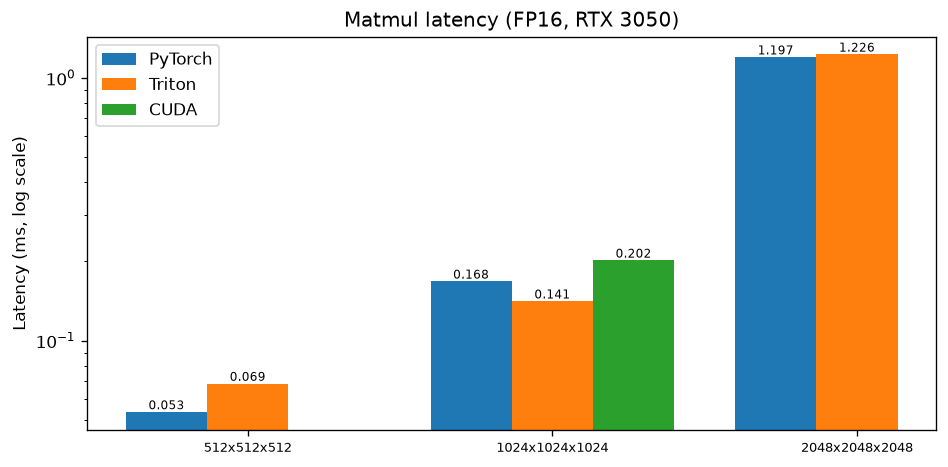
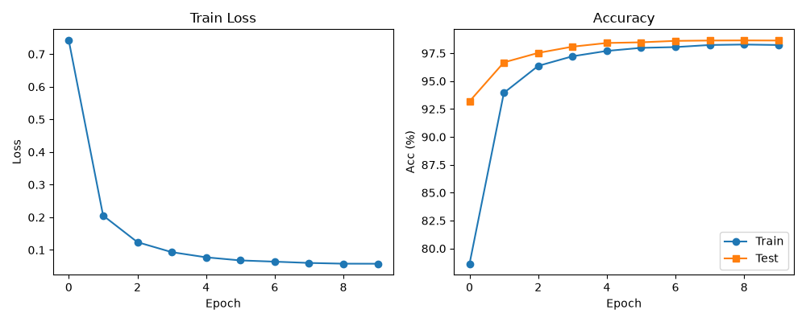

# Performance Report

**Generated:** 2026-11-01 14:39 UTC  
**Device:** NVIDIA GeForce RTX 3050 6GB Laptop GPU (measurements from 2026-03-15)

> **Partial report.** Rows produced by kernels that were later found to compute wrong results
> (Triton FlashAttention / conv / CUDA attention / CUDA QKV, see [docs/ENGINEERING_LOG.md](../docs/ENGINEERING_LOG.md))
> or whose code has since changed were removed. Regenerate the full, verified report on a GPU with
> `python tools/performance_dashboard.py --skip-mnist`.

---

## Summary

- Report built from existing CSV files (benchmarks were not re-run after the fixes).
- Chart generation was skipped.

### Highlights

- **Transformer Kernels (QKV, Softmax, LayerNorm, GELU, MLP):** Best latency **0.0548 ms** (GELU (Triton)).
- **Conv2D (3×3, FP16):** Best latency **0.06 ms** (PyTorch).
- **Matrix Multiply (FP16):** Best latency **0.0773 ms** (PyTorch).
- **Attention (SDPA / Flash):** Best latency **0.022 ms** (PyTorch).

---

## Performance Tables

### Matrix Multiply (FP16)

| implementation | size | latency_ms | gflops | memory_bandwidth_gbs | gpu_utilization_pct |
| --- | --- | --- | --- | --- | --- |
| PyTorch | 512x512x512 | 0.0773 | 3473.81 | 20.35 |  |
| PyTorch | 1024x1024x1024 | 0.1676 | 12816.36 | 37.55 |  |
| PyTorch | 2048x2048x2048 | 1.1545 | 14881.07 | 21.8 |  |

### Conv2D (3×3, FP16)

| implementation | config | latency_ms | gflops | memory_bandwidth_gbs | gpu_utilization_pct |
| --- | --- | --- | --- | --- | --- |
| PyTorch | B32_C1x32_28x28 | 0.06 | 207.64 | 23.92 |  |
| PyTorch | B128_C1x32_28x28 | 0.1675 | 297.54 | 34.26 |  |
| PyTorch | B128_C1x64_64x64 | 1.6721 | 338.99 | 38.29 |  |

### Attention (SDPA / Flash)

| implementation | config | latency_ms | gflops | memory_bandwidth_gbs | gpu_utilization_pct |
| --- | --- | --- | --- | --- | --- |
| PyTorch | B2_H8_S128_D64 | 0.022 | 3057.35 | 47.77 |  |
| PyTorch | B4_H8_S256_D64 | 0.0743 | 7226.69 | 56.46 |  |
| PyTorch | B2_H8_S512_D64 | 0.1048 | 10249.21 | 40.04 |  |

### Transformer Kernels (QKV, Softmax, LayerNorm, GELU, MLP)

| kernel | implementation | latency_ms | gflops | memory_bandwidth_gbs |
| --- | --- | --- | --- | --- |
| QKV | PyTorch | 0.8751 | 8281.95 | 18.43 |
| Softmax | PyTorch | 0.0643 |  | 97.85 |
| Softmax | Triton | 0.0907 |  | 69.36 |
| LayerNorm | PyTorch | 0.0629 |  | 100.08 |
| LayerNorm | Triton | 0.0622 |  | 101.23 |
| GELU | PyTorch | 0.0714 |  | 88.17 |
| GELU | Triton | 0.0548 |  | 114.85 |
| MLP | PyTorch | 1.5542 | 12435.35 | 18.22 |

---

## Benchmark Charts

Charts are saved in `benchmarks/plots/` and `benchmarks/*.png`.

- `matrix_mul_speedup.png`
- `mnist_acc_loss.png`

Example embedding (paths relative to this report in `benchmarks/`):

---

*Report generated by `tools/performance_dashboard.py`*
