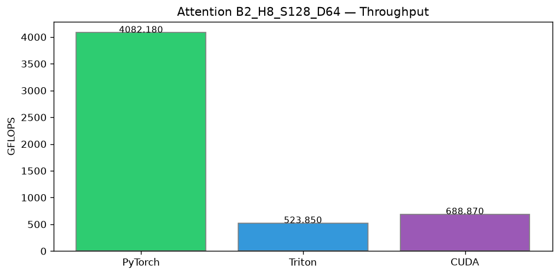
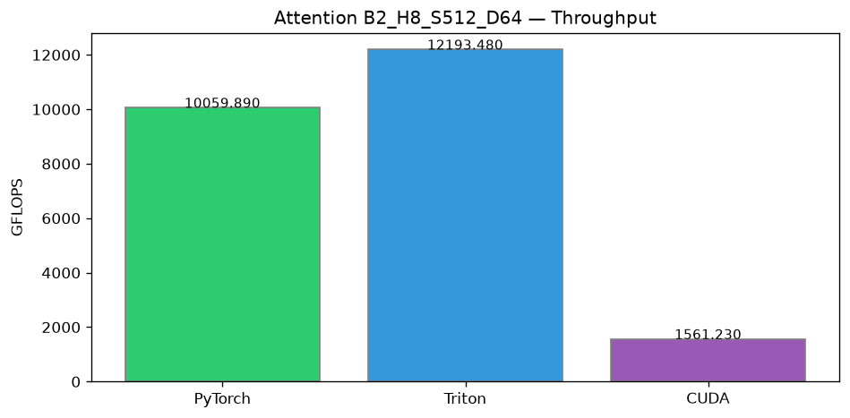
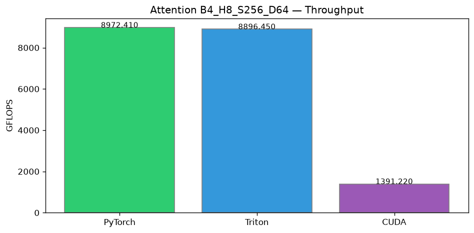
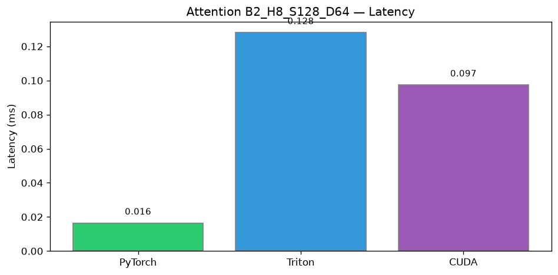
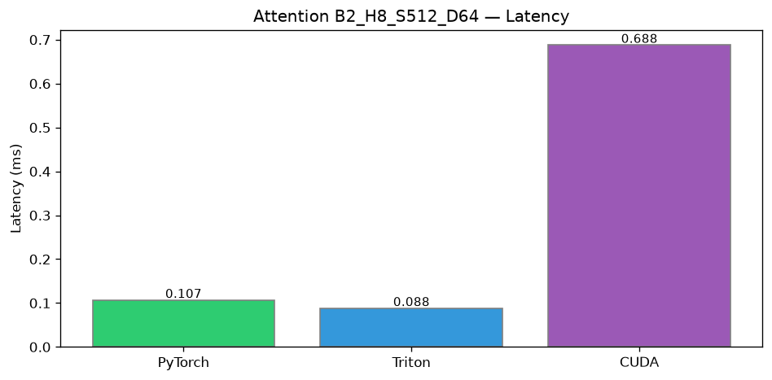
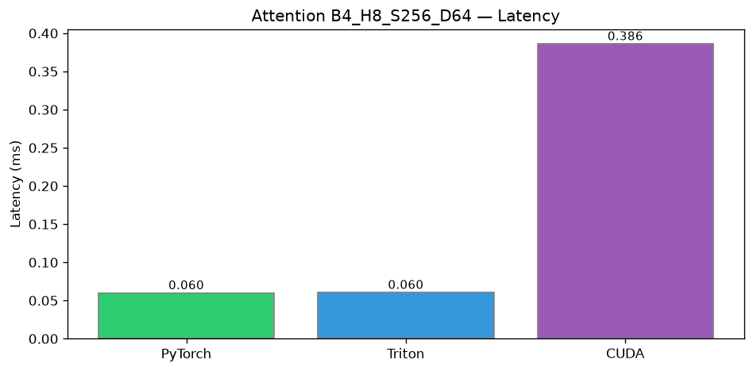

# Performance Report

**Generated:** 2026-11-02 03:52 UTC  
**Device:** NVIDIA GeForce RTX 3050 6GB Laptop GPU

---

## Summary

- Report built from existing CSV files (benchmarks were not run).
- Chart generation was run (e.g. `generate_charts.py`).

### Highlights

- **Attention (SDPA / Flash):** Best latency **0.037 ms** (PyTorch).
- **Conv2D (3×3, FP16):** Best latency **0.0356 ms** (CUDA).
- **Matrix Multiply (FP16):** Best latency **0.0534 ms** (PyTorch).
- **Transformer Kernels (QKV, Softmax, LayerNorm, GELU, MLP):** Best latency **0.0544 ms** (Softmax (PyTorch)).

---

## Performance Tables

### Matrix Multiply (FP16)

| implementation | size | latency_ms | gflops | memory_bandwidth_gbs | gpu_utilization_pct |
| --- | --- | --- | --- | --- | --- |
| PyTorch | 512x512x512 | 0.0534 | 5025.77 | 29.45 |  |
| Triton | 512x512x512 | 0.0685 | 3919.25 | 22.96 |  |
| PyTorch | 1024x1024x1024 | 0.1678 | 12795.66 | 37.49 | 96.0 |
| Triton | 1024x1024x1024 | 0.141 | 15234.29 | 44.63 | 86.0 |
| CUDA | 1024x1024x1024 | 0.2017 | 10645.44 | 31.19 |  |
| PyTorch | 2048x2048x2048 | 1.1966 | 14357.42 | 21.03 |  |
| Triton | 2048x2048x2048 | 1.2261 | 14012.15 | 20.53 |  |

### Conv2D (3×3, FP16)

| implementation | config | latency_ms | gflops | memory_bandwidth_gbs | gpu_utilization_pct |
| --- | --- | --- | --- | --- | --- |
| PyTorch | B32_C1x32_28x28 | 0.0841 | 148.14 | 17.06 | 95.0 |
| Triton | B32_C1x32_28x28 | 0.0713 | 174.72 | 20.13 | 94.0 |
| CUDA | B32_C1x32_28x28 | 0.0356 | 349.66 | 80.55 |  |
| PyTorch | B128_C1x32_28x28 | 0.1684 | 295.91 | 34.07 |  |
| Triton | B128_C1x32_28x28 | 0.0832 | 599.11 | 68.99 |  |
| CUDA | B128_C1x32_28x28 | 0.1245 | 400.33 | 92.2 |  |
| PyTorch | B128_C1x64_64x64 | 1.6803 | 337.33 | 38.11 |  |
| Triton | B128_C1x64_64x64 | 1.0442 | 542.81 | 61.32 |  |

### Attention (SDPA / Flash)

| implementation | config | latency_ms | gflops | memory_bandwidth_gbs | gpu_utilization_pct |
| --- | --- | --- | --- | --- | --- |
| PyTorch | B2_H8_S128_D64 | 0.037 | 1813.99 | 28.34 | 94.0 |
| Triton | B2_H8_S128_D64 | 0.0933 | 719.3 | 11.24 | 94.0 |
| CUDA | B2_H8_S128_D64 | 0.0974 | 688.87 | 21.53 |  |
| PyTorch | B4_H8_S256_D64 | 0.0595 | 9018.72 | 70.46 |  |
| Triton | B4_H8_S256_D64 | 0.0637 | 8424.55 | 65.82 |  |
| CUDA | B4_H8_S256_D64 | 0.3859 | 1391.22 | 21.74 |  |
| PyTorch | B2_H8_S512_D64 | 0.106 | 10131.17 | 39.57 |  |
| Triton | B2_H8_S512_D64 | 0.0881 | 12193.48 | 47.63 |  |
| CUDA | B2_H8_S512_D64 | 0.6878 | 1561.23 | 12.2 |  |

### Transformer Kernels (QKV, Softmax, LayerNorm, GELU, MLP)

| kernel | implementation | latency_ms | gflops | memory_bandwidth_gbs |
| --- | --- | --- | --- | --- |
| QKV | PyTorch | 0.5449 | 13300.8 | 29.6 |
| QKV | Triton | 0.5865 | 12357.5 | 27.5 |
| QKV | CUDA | 0.6748 | 10741.3 | 23.9 |
| Softmax | PyTorch | 0.0544 |  | 115.7 |
| Softmax | Triton | 0.0569 |  | 110.5 |
| Softmax | CUDA | 0.0939 |  | 67.0 |
| LayerNorm | PyTorch | 0.0563 |  | 111.8 |
| LayerNorm | Triton | 0.0667 |  | 94.4 |
| LayerNorm | CUDA | 0.1106 |  | 56.9 |
| GELU | PyTorch | 0.0555 |  | 113.3 |
| GELU | Triton | 0.0544 |  | 115.7 |
| GELU | CUDA | 0.0564 |  | 111.5 |
| MLP | PyTorch | 1.6118 | 11991.5 | 9.8 |
| MLP | Triton | 1.6336 | 11831.4 | 9.6 |
| MLP | CUDA | 1.6808 | 11498.8 | 9.4 |

---

## Benchmark Charts

Charts are saved in `benchmarks/plots/` and `benchmarks/*.png`.

- `plots/attention_gflops_B2_H8_S128_D64.png`
- `plots/attention_gflops_B2_H8_S512_D64.png`
- `plots/attention_gflops_B4_H8_S256_D64.png`
- `plots/attention_latency_B2_H8_S128_D64.png`
- `plots/attention_latency_B2_H8_S512_D64.png`
- `plots/attention_latency_B4_H8_S256_D64.png`
- `plots/attention_latency_by_config.png`
- `plots/conv_gflops_B128_C1x32_28x28.png`
- `plots/conv_gflops_B128_C1x64_64x64.png`
- `plots/conv_gflops_B32_C1x32_28x28.png`
- `plots/conv_latency_B128_C1x32_28x28.png`
- `plots/conv_latency_B128_C1x64_64x64.png`
- `plots/conv_latency_B32_C1x32_28x28.png`
- `plots/conv_latency_by_config.png`
- `plots/matmul_gflops_1024_1024_1024.png`
- `plots/matmul_gflops_2048_2048_2048.png`
- `plots/matmul_gflops_512_512_512.png`
- `plots/matmul_latency_1024_1024_1024.png`
- `plots/matmul_latency_2048_2048_2048.png`
- `plots/matmul_latency_512_512_512.png`
- `plots/matmul_latency_by_size.png`
- `plots/transformer_gelu_latency.png`
- `plots/transformer_latency_by_kernel.png`
- `plots/transformer_layernorm_latency.png`
- `plots/transformer_mlp_latency.png`
- `plots/transformer_qkv_latency.png`
- `plots/transformer_softmax_latency.png`
- `matrix_mul_speedup.png`
- `conv_benchmark.png`
- `mnist_acc_loss.png`

Example embedding (paths relative to this report in `benchmarks/`):

*... and 24 more in `benchmarks/plots/`*

---

*Report generated by `tools/performance_dashboard.py`*
